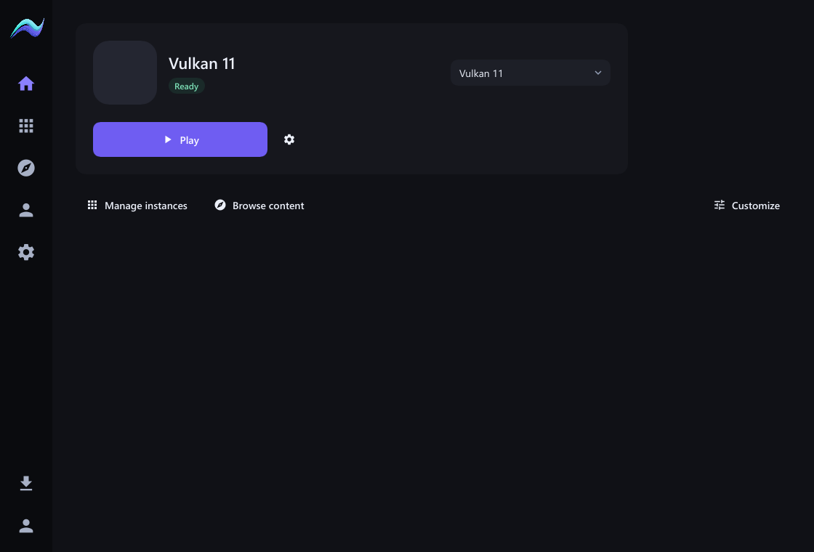
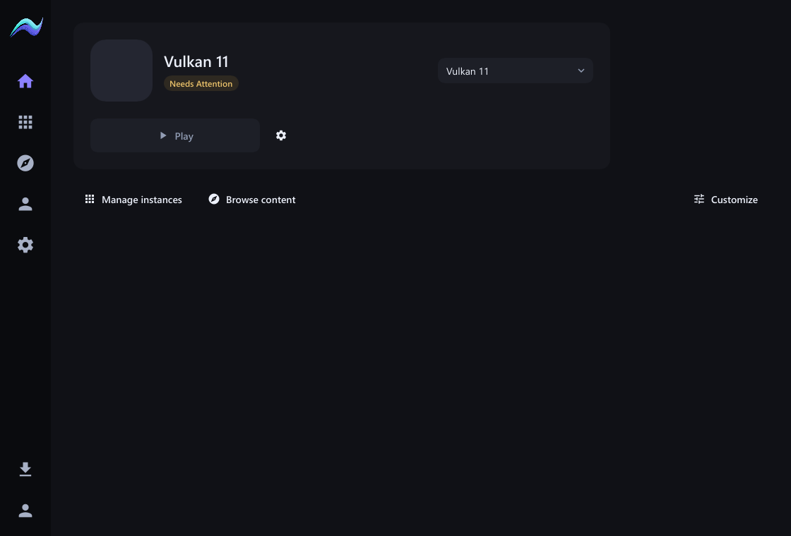
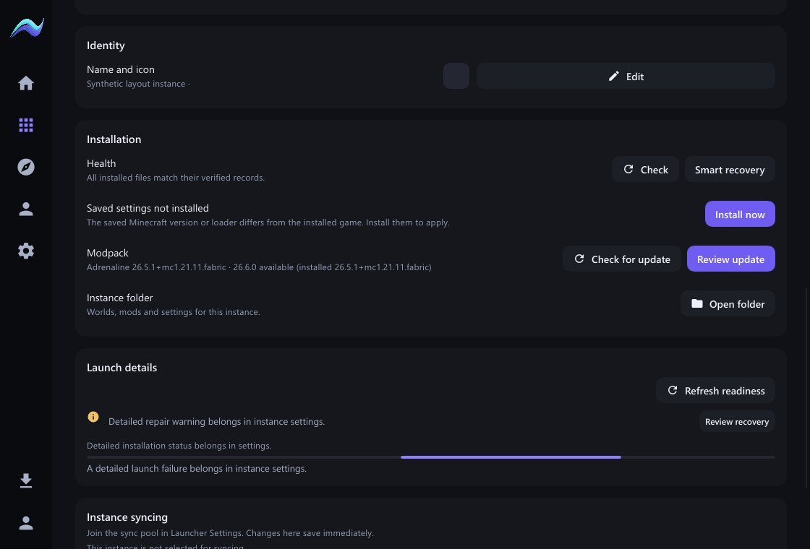
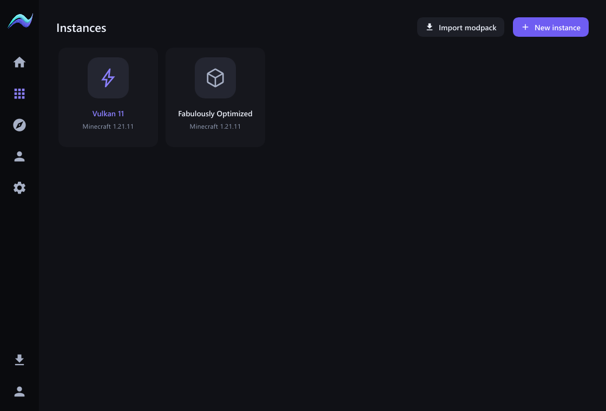

# Home card simplification

2026-11-01. Native UI follow-up from `edfd055` on `codex/pandora-backend`.

The Home card's job is to select an instance and play. Its only visible status text is now **Ready** or **Needs Attention**. Removed from the card: detailed blockers, recovery actions, launch/install progress copy and bars, checking labels, and previous-game exit messages (including code 0). The Play control keeps its action label; busy/running exclusion and the Rust-owned readiness checks remain authoritative.

All detailed messages and blocker actions are presented in the selected instance's **Settings → Launch details** section. Manual readiness refresh is there too; existing file-health, Java and Smart Recovery controls remain in settings. A gear on Home opens that instance's settings. Returning to an already open workspace preserves its unsaved configuration draft, including custom RAM. A blocked workspace Play request opens settings instead of showing a recovery dialog on Home.

The Instances grid now shows only **icon → instance name → Minecraft version**. Installed/repair badges, Fabric identifiers and modpack version text are removed from these cards, including their accessible descriptions. The version comes directly from the structured Minecraft version field. Detailed workspace/settings information remains available. Cards use a compact square layout, and the Import modpack and New instance buttons have the existing 16 px spacing token between them.

The implementation reuses existing shared theme, button, status, progress and settings controls. The card becomes shorter, with no new decorative treatment or background work. No instance files, persisted settings/schema, installation/launch authority, dependencies or lockfiles changed. This is a presentation change; no performance improvement is claimed.

## Verification

- Native all-target check passed; the final run passed **45 native tests and 5 Java-picker/contract tests**.
- A rendering invariant checks that a Home frame is identical with and without diagnostic messages, blockers and progress strings in state. A real pointer click dispatches the gear action once. Returning to settings retains an 8192 MiB unsaved draft. Existing Play navigation, recovery, memory-entry and keyboard tests still pass.
- The actual Slint software renderer captured Ready, Needs Attention and settings detail states at 720×520, 1120×760 and 1600×1000; minimum-size scaling covers 100%, 125%, 150% and 200%. Shared controls retain their keyboard/focus/accessibility behavior; Play's accessible description still communicates its operational state.
- The same native renderer also captured the simplified two-card grid at every size/scale above, including the longer Fabulously Optimized name and separated header actions.
- Frontend type check: 0 errors, 0 warnings. Native Rust formatting and whitespace checks passed. Shared backend behavior was not changed or reclassified.
- The owner's screenshot supplied the baseline with the extra exit message. The captures below use synthetic test data and existing tokens, without copying the owner's account artwork into the repository.
- The optimized native build passed and was opened on Windows. Live verification observed Home reach **Ready** with Play enabled and no exit/detail labels; the gear opened the selected instance's settings and its Launch details refresh control. The live Instances grid showed both existing instances with icon/name/Minecraft version only and separated header buttons. The updated launcher is left open on Instances. No game launch or instance-content change was needed for this acceptance.
- Local acceptance executable: `C:\Dev\aurora-pandora-evidence-20261101\native-target\release\aurora-native.exe`, 34,975,232 bytes, SHA-256 `78b6c84a8b799c2af0f4ae8fea2c80c031fe531f6aa50fa49dd0dae802fa4ad7`. Existing acceptance-only data-root feature retained; no distribution release or installed WebView application replacement.

Repository status, history, tracked files and critical-file baselines were recorded before edits. Baseline tracked files remain present, and no deletion or generated game/runtime data is included. No push or publication.

**AURORA CLIENT HANDOFF: NOT YET REQUIRED**
