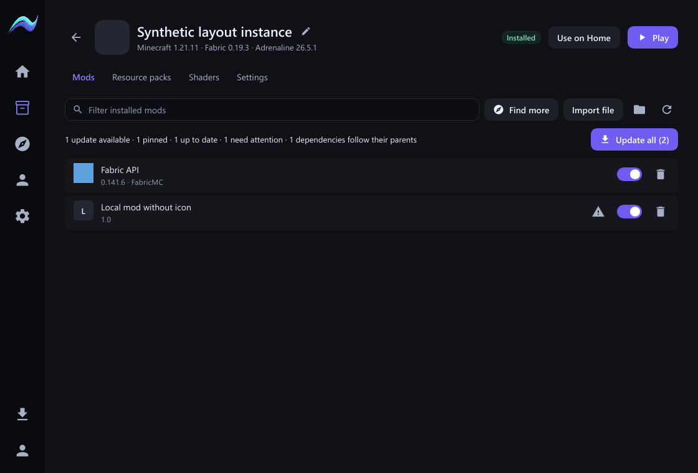
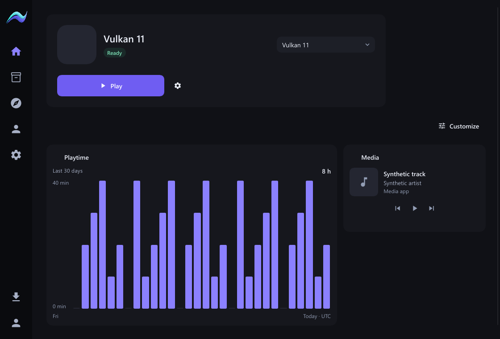
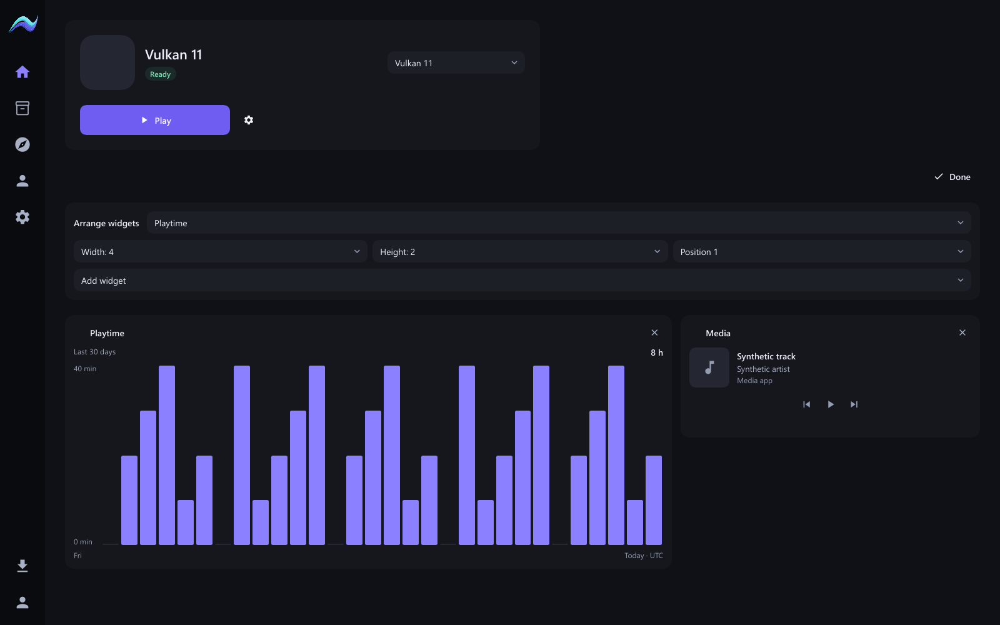
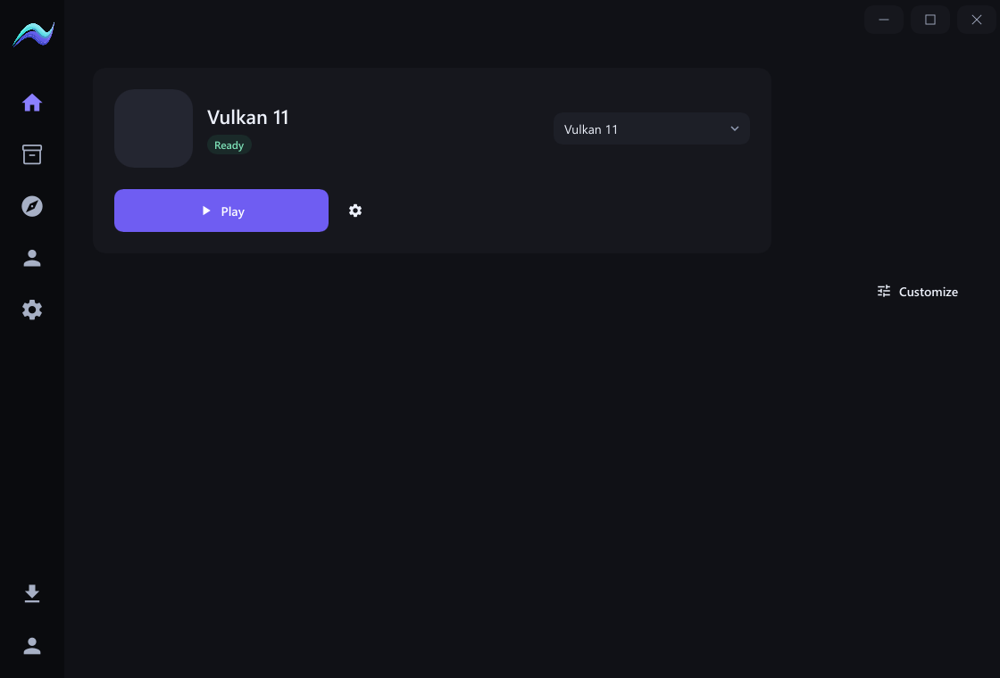
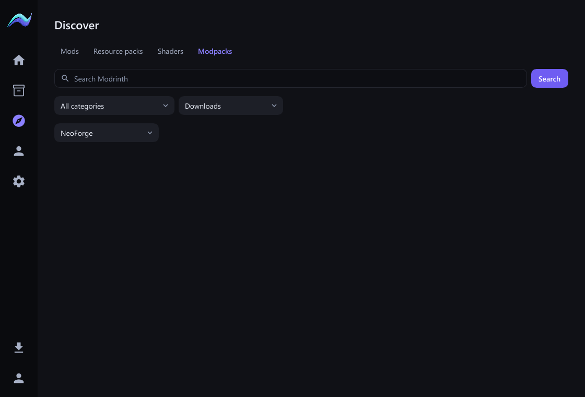

# Native controls, widgets and Client discovery

2026-11-01; follow-up to `b900c85` on `codex/pandora-backend`.

The screen's job is to manage instance content and arrange a quiet, useful Home.
This change keeps the existing native renderer, core installation authority,
verified artifact stores, process supervision and saved user content.

## Requested behavior

| Request | Implemented behavior |
| --- | --- |
| Align toggles and deletion icons | Shared 36 px action slots center the 22 px switches against 36 px delete/warning controls. |
| Omit bundled resource packs | Rust marks installed-pack-owned entries explicitly; the native resource-pack list hides those entries. Personal packs remain visible and all files stay on disk. No filename-based deletion or ownership inference. |
| Inventory 2 navigation icon | Uses the existing checked-in Google Material Symbols `inventory_2` path. |
| Simplify Home navigation | Removed Manage instances and Browse content; sidebar navigation remains. |
| Larger window controls | 52×44 px caption targets with larger glyphs, restrained rounded surfaces, accent hover, destructive close hover, keyboard access and focus rings. OS drag/resize/maximize callbacks remain unchanged. |
| Modpack loader filter | All loaders, Fabric, Forge and NeoForge are independent of thematic category and sort. Filters combine as AND facets; no implicit installation compatibility or loader change. |
| Combine content refresh/update checks | One refresh icon reloads inventory and starts the bounded provider check; duplicate checks are excluded while busy. Removed the separate check button. |
| Check published Aurora versions | The owner-designated GitHub releases replace the missing release-manifest endpoint for normal discovery, review and apply. See trust and live evidence below. |
| Fine-grained widget sizing and placement | Customize selects a widget, width 1–6 cells, height 1–3 rows and direct order position, with an immediate responsive preview and add/remove controls. Geometry persists through the atomic core configuration API. Writes serialize and coalesce rapid edits. Narrow windows preserve requested dimensions while laying out non-overlapping cards. |
| Playtime graph | Recorded daily bars replace the totals list. Compact cards show seven days; enlarged cards show thirty, with a common vertical scale, numeric total, UTC labels, per-day hover values and accessible descriptions. Uses the existing history API. |
| Media note removal | Removed the volume/Windows limitation paragraph from the media card. Playback controls remain. |

## Publication trust and limits

The previous release-manifest URL returned 404. The owner supplied the published
v3.2.0 release URL and digest and authorized this repository as the source. Normal
checks now read at most 30 public release records (bounded to 1 MiB), reject drafts
and prereleases, select the exact repository/tag JAR and require its GitHub SHA-256
asset digest. Missing or ambiguous artifact metadata fails visibly, never becomes
an unverified install or a false update offer. HTTPS authenticates publication
metadata; no independent publisher signature is claimed.

Before compatibility inspection the JAR is acquired through the SHA-256 store.
Its mod ID/version, Minecraft/Loader/Java predicates, Fabric API dependency and
mixin Java requirements must fit the existing exact reviewed environment. Unknown
new required dependencies fail deliberately. Existing reviewed Fabric API metadata
is preserved, and the normal full preview still performs deep instance validation.
Apply re-fetches the source and re-derives the approved fingerprint. No automatic
update, new-instance selection change or launcher self-update authority change.

An explicit live diagnostic (`src-tauri/examples/client_release_probe.rs`) ran
against public releases in a newly created disposable cache. It resolved **Aurora
3.2.0**, verified the real JAR against
`fb7a7c0c10c383fd55da13627614099b35501d831b9372cac196bbb73ffaebb8`,
and accepted Minecraft 1.21.11 / the probe's unchanged Fabric 0.19.5 environment.
This probe neither loads nor modifies owner instances. Deterministic tests remain
offline/loopback; the explicit live probe is separate.

An instance without Aurora reports Not installed before contacting update services.
This check does not install Aurora into a modpack; the existing explicit add/review
workflow remains separate. Older readers reject optional widget geometry when
present; no speculative migration or downgrade rewrite is performed.

## Verification and evidence

- Core all-target check (without the WebView host) passed. Final core suite:
  **1,105 passed, 31 existing opt-in tests ignored**.
- Frontend check: **0 errors, 0 warnings**; **301 tests passed**; production web
  build passed. No frontend product redesign is included.
- Native suite: **48 UI/domain tests and 5 Java-picker/contract tests passed**.
  The final scoped rerun again passed all 48 UI/domain tests, including preserving
  bundled shaders while hiding bundled resource packs.
- Native renderer/input coverage includes compact/enlarged graphs, layout editor,
  caption controls, loader filter and content rows at 720×520, 1120×760 and
  1600×1000; minimum-size scaling includes 100%, 125%, 150% and 200%.
- Pure layout tests verify no overlapping cells at every column count, saved
  dimensions survive narrow windows and direct placement preserves other entries.
  Core tests verify legacy round trips and geometry bounds. History tests verify
  real daily values, zero activity and common graph scaling. Published-release
  tests cover identity, digests, drafts, URLs and incompatible dependencies.
- Existing Borealis no-idle-frame regression remains in the native suite. No new
  chart polling/idle animation is introduced. Performance is **not measured**;
  no speed, CPU or memory improvement is claimed.
- Live native acceptance verified the Inventory 2 icon, aligned mod action columns,
  a single refresh starting both inventory reload and update discovery, and the
  Fabulously Optimized resource-pack tab retaining the personal overlay while
  hiding its three bundled helper packs. No mods or pack files were changed.
- Live widget editing changed Playtime from width 2/height 1 to width 4/height 2,
  moved it to position 2, and restored position 1 using the keyboard. The responsive
  preview updated immediately; the saved configuration recorded width 4/height 2
  and preserved the other widget entries. Actual recorded history remained five
  minutes. The media card showed real artwork/playback controls without the note.
- Live maximize worked. Final hover inspection identified and fixed an overlong
  right-edge tooltip: the refresh icon retains the short **Refresh** label, with
  the combined behavior in its accessible description.
- Final optimized build passed (`lto=thin`, native binary `codegen-units=16`),
  followed by a real restart. The saved enlarged graph survived restart, Home
  reached Ready, and Media retained its controls without the removed note.
  The live NeoForge filter changed Modrinth results from 19,114 to 2,647 matches.
  Manual Client checking correctly reported that Aurora is absent from the
  selected instance, without the old 404. No Client installation was performed.
- Accepted local executable:
  `C:\Dev\aurora-pandora-evidence-20261101\native-target\release\aurora-native.exe`,
  37,522,944 bytes, SHA-256
  `17d8b9f368271830ea0e7a1650c6ab3aa6c6edaa69001455049abcc1846b05ae`.
  The updated launcher is left open on Home with the enlarged playtime graph.

Captures below are from the actual Slint software renderer using synthetic data,
not a mockup or owner account artwork. Owner attachments supply the before state.

Repository baseline includes status, history, tracked files and critical manifests.
No dependencies, lockfiles or existing user/game files are removed. No push or
publication. This is Launcher work; **AURORA CLIENT HANDOFF: NOT YET REQUIRED**.
