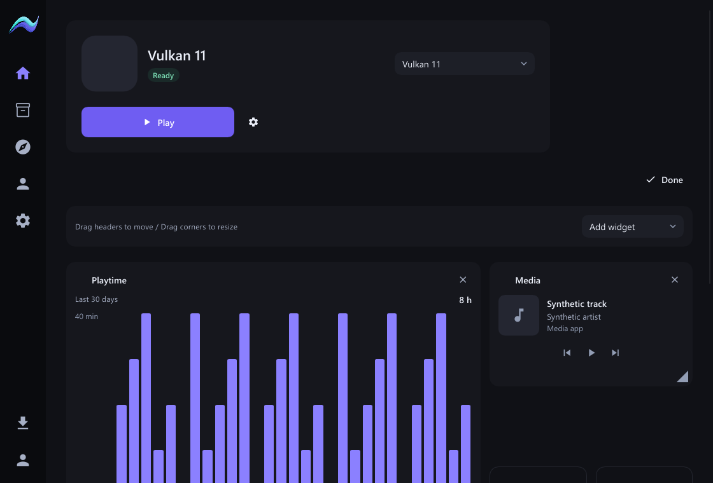
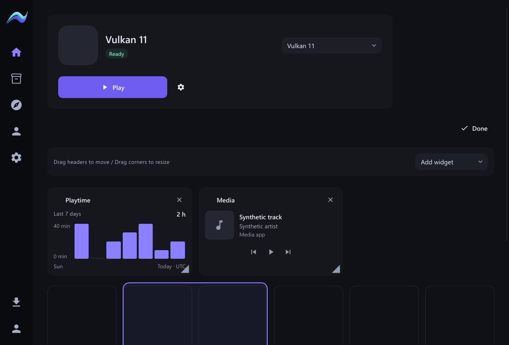
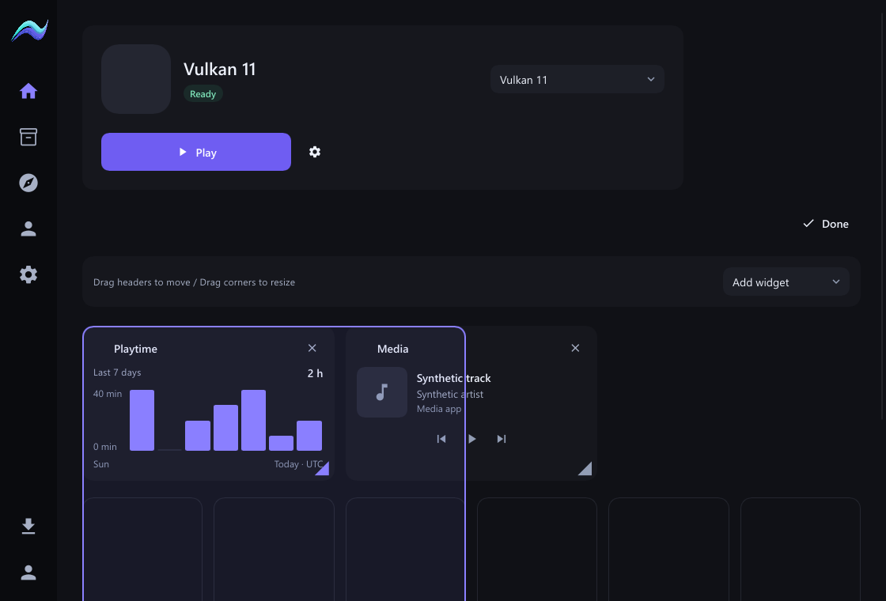

# Native widget dragging and resizing

The Home Customize action now opens direct manipulation: drag a header to move a
widget, or its lower-right corner to resize. A visible grid and snapped outline
show the proposed cell footprint. Release commits once; Escape cancels. Arrow
keys move one cell; Shift+arrows resize. The corner handle also accepts arrows.
The prior width/height/position dropdowns are removed. Add, remove, real playtime
history, system-media controls and unknown saved widget entries remain supported.

Geometry is resolved in Rust, with collision displacement and deterministic
non-overlapping placement. The core validates the optional anchor and saves
atomically. Existing presets and dimensions-only documents remain valid. Window
resizing clamps rendered spans without writing configuration. No dependencies,
network requests, idle animations or new polling are added. Performance has not
been measured. This change belongs to Launcher.

Verification:

- Native suite: 49 passed. Real Slint pointer events exercise header dragging,
  snapped preview without saving, one edit on release, Escape cancellation,
  keyboard movement and corner resizing in both axes. Collision and unknown-entry
  tests verify the Rust/core contract and serialization.
- Core Home layout: 7 passed, covering legacy documents, bounds and optional
  anchors. Core all-target checking and both Rust formatting checks passed.
- Frontend checking: no errors or warnings; production frontend build passed.
- Actual Slint software-renderer scenes cover 720x520, 1120x760 and 1600x1000,
  including minimum-window scaling at 100%, 125%, 150% and 200%. Captures below
  use synthetic data; no owner media artwork or private game files are committed.

Live acceptance caught a transient-width event arriving during a drag: a queued
old column count could displace cards into a narrow layout. The gesture now
supplies its actual grid column count, and width changes record the latest value
synchronously before deferred rendering. Pointer tests assert the correct column
count. The original owner layout was restored before final acceptance.

Final live optimized acceptance passed: dragged Servers into Media's row and
back; collision displacement retained column four and the original spans. Resized
Playtime from four columns to three and back, retaining two rows. Saved geometry
matches the original arrangement (Playtime 4x2 at [0,0], Servers 2x1 at [4,0], Media
2x1 at [4,1]); all other saved widget entries are unchanged. Home reached Ready.
The optimized build passed with thin LTO and 16 binary code-generation units.
A real restart restored the anchored layout and reached Ready again.

Executable: `C:/Dev/aurora-pandora-evidence-20261101/native-target/release/aurora-native.exe`
(37,700,608 bytes), SHA-256
`d083fa425e358fa2588156f885da883df9a55c33f81a165ad68a7884118a87a4`.

No tracked files disappeared; root documentation/manifests/lockfiles remain.
No dependencies or game/mod files changed. No push or publication.

**AURORA CLIENT HANDOFF: NOT YET REQUIRED**
