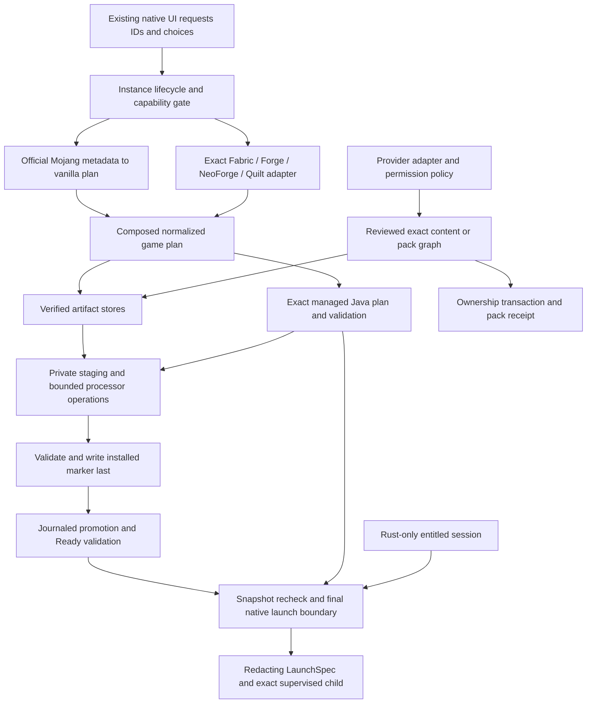

# Multi-loader and provider architecture proposal

F0 proposal, 2026-10-10–11. Baseline `9890a9c8ba2b0fb64508df60d9ea8fd860a21f64`. **None of the types, schemas, commands or modules proposed here were implemented in F0.** Existing behavior and evidence are documented in the [audit](../compatibility/FORGE_CURSEFORGE_F0_AUDIT.md); delivery gates are in the [roadmap](../compatibility/FORGE_CURSEFORGE_ROADMAP.md).

## 1. Decision and invariants

Extend the existing concrete loader adapters around one independently meaningful vanilla plan, one composed game plan, one verified installer, and one Rust-owned launch boundary. Forge and NeoForge share a small normalized processor execution core with separate metadata/generation adapters. Quilt remains its own adapter. Use a closed enum and exhaustive functions; no dynamic plugins, service container, universal Maven resolver or trait hierarchy is needed for five known families.

Extend the existing content lifecycle with a closed provider facade and typed source records. Modrinth and CurseForge own their discovery, identity, dependency and distribution semantics; the shared core owns exact graph decisions, verified activation, ownership, removals and recovery. Local files are a source kind, not a fabricated provider. Aurora remains a separate launcher-owned capability.

Preserve these contracts:

- `com.aurora.launcher`, application-local paths, validated `InstanceId`, independent account/instance selection, old exact release pins and known migrations.
- Expected SHA-1/SHA-256/SHA-512, transport observation and locally generated output are different trust facts. An observed SHA-256 cannot promote other evidence into publisher verification.
- DTOs contain identifiers, summaries and reviewed fingerprints; Rust resolves all network sources, paths, tokens, executable/arguments and final authority.
- Unknown versions, unsupported metadata expressions, malformed state, unsafe paths and stale reviews fail deliberately without overwriting existing data.
- Ready requires complete validation, not an enum variant or stored flag. Partial required pack content never reaches Ready.
- Provider outages and CF configuration cannot block unrelated installed instances. No automatic update, source switch or loader substitution.
- User saves/config/logs/manual content remain user property. Repair only mutates exact manifest-proven launcher resources or separately reviewed owned pack paths.
- Existing publication/signing/Client release authority and Microsoft registration remain unchanged.

## 2. Module boundaries and data flow

Proposed paths are introduced only when their first behavior is implemented. Preserve reexports or narrow compatibility wrappers during moves so boundary refactoring can be reviewed independently from new semantics.

| Boundary | Proposed home | Owns / does not own |
| --- | --- | --- |
| Vanilla game | Existing `minecraft/*` | Official base discovery, documents, platform rules, assets/libraries/native requirements; no loader inheritance |
| Composition | `game/plan.rs` moved from `fabric/plan.rs` | Typed base plus optional concrete loader, ordered effective libraries/arguments, explicit collision decisions |
| Fabric | Existing `fabric/*` | Fabric Meta parsing, exact combinations, family libraries/entrypoint/predicates |
| NeoForge | Existing `neoforge/*` | Official discovery, profile generations, tokens, artifacts, launch and mod metadata; retains existing 26.x |
| Forge | `forge/{metadata,plan,mods,mod}.rs` | Official Maven discovery and supported installer generations, precise MC mapping, launch/mod semantics |
| Quilt | `quilt/{metadata,plan,mods,mod}.rs` | Official Meta/profile generation, Quilt mappings and metadata semantics |
| Processor mechanics | `install/processors.rs` | Typed operations, private input materialization, bounded execution/output validation; no raw installer JSON or loader-version policy |
| Game install/state | Existing `install/*` | Cache acquisition, materialization, native extraction, validation, installed marker and replacement receipt |
| Managed runtime | Existing `runtime/*` | Exact component/platform/file plans and validation; no system-Java fallback |
| Provider facade | Small `providers/mod.rs` | Closed dispatch and normalized search/detail/file plans; no filesystem mutation |
| Provider adapters | Existing `modrinth.rs`; `curseforge/{metadata,policy,mod}.rs` | Provider endpoints, IDs, filters, relations, permission and authorized request scopes |
| Content domain | Existing `instance_content.rs`, recognition/update modules | Exact entries, ownership, graph/satisfaction, hash-bound review and lifecycle |
| Pack normalization | Existing `mrpack.rs`; `curseforge/pack.rs`; shared `modpacks.rs` | Format DTOs become a closed `PackInstallPlan`; no raw JSON reaches executors |
| Pack state/reconciliation | Existing `pack_state`, `pack_update`, `pack_activation` | Source-neutral authored snapshots, divergent files, transaction/recovery |
| Native/UI | Existing `application.rs`, `backend.ts`, workspace/Browse components | Typed summaries and explicit reviews; no frontend compatibility solver |



## 3. Loader identity, capabilities and normalized plans

Reuse current serialized `PlatformPin` kinds: `vanilla`, `fabric`, `forge`, `neoForge`, `quilt`. Keep native wire spelling stable; adapter mappings such as Modrinth `neoforge` and CF loader enum 6 remain separate. Do not make `PlatformPin` store API URLs or JAR paths.

Illustrative Rust signatures below describe boundaries, not compiling patches. Names wrapping IDs/paths/digests imply validated newtypes.

```rust
enum ResolvedLoaderPlan {
    Fabric(FabricPlan),
    Forge(ForgePlan),
    NeoForge(NeoForgePlan),
    Quilt(QuiltPlan),
}

struct GameInstallPlan {
    minecraft: MinecraftInstallPlan, // unchanged independent base
    loader: Option<ResolvedLoaderPlan>,
    effective: EffectiveGamePlan,
}

struct EffectiveGamePlan {
    platform: PlatformPin,
    main_class: MainClass,
    libraries: Vec<PlannedLibrary>,
    jvm_arguments: Vec<ArgumentGroup>,
    game_arguments: Vec<ArgumentGroup>,
    game_java: JavaRequirement,
    installation_tools: Vec<ToolRuntimeRequirement>,
    client_processing: Vec<ProcessorStep>,
}

struct PlannedLibrary {
    identity: LibraryIdentity,
    relative_path: ManagedRelativePath,
    source: PlannedArtifact,
    roles: LibraryRoles, // game classpath, module path, native input, tool only
    provenance: LibraryProvenance,
}
```

Vanilla has no loader plan, loader version or fake Fabric identity. Loader overlays must name exactly the selected Minecraft version; only the adapter interprets its supported `inheritsFrom`. Reject arbitrary chains, cycles, local version lookup and other loader inheritance until explicitly supported. Mojang DTO rejection of loader-profile inheritance should remain intact.

Compose in deterministic documented order. Exact identical libraries may collapse. Conflicting same-identity versions stay blocked unless a tested family/generation rule explicitly selects/replaces one with recorded provenance. Avoid both blind deduplication and an indiscriminate “loader wins” policy. Classifier coexistence and module-path/tool roles must survive normalization. Never scan a directory to reconstruct the classpath.

Replace family-wide booleans as the sole selector with a native capability query for **Minecraft + loader family + exact version + host platform + operation**. It may return Installable, RepresentedOnly, UnsupportedGeneration, UnsupportedPlatform or ResearchOnly with a sanitized reason. These are proposed decision DTOs, not new persisted Ready states. Existing broad catalog can remain as discovery UI vocabulary, backed by exact gates before review/install.

Required content comes from optional capabilities: Aurora contributes only its reviewed Fabric-compatible artifacts, exact SHA-256 and protected identities. A new loader does not gain Aurora or Fabric API by default. No speculative bridge to run Aurora on another family is proposed.

## 4. Forge/NeoForge installer boundary

Each adapter selects exact official metadata, acquires the installer through the expected SHA-1 store, reads bounded unique JSON/resource entries, and emits one supported-generation plan. The generic executor never opens raw install-profile JSON or discovers a newer loader.

Initial generations:

- Existing NeoForge 26.x processing vocabulary, kept compatible through a separately reviewable move.
- Forge 26.2 spec-1 bootstrap/patch profile, then Forge 1.20.1 mapping pipeline.
- Older NeoForge mapping pipeline with its own exact artifact/token/output semantics.
- Legacy Forge `install`/`versionInfo`, spec-0 variants and older Mojang native/argument shapes in later bounded slices.

Do not use the install-profile `spec` integer alone as a generation switch: F0 samples demonstrate several behaviors under spec 0/1. Validate fields and operations against pinned fixtures and reject newly encountered behavior rather than half-executing it.

```rust
struct ProcessorStep {
    tool: VerifiedToolRef,
    runtime: ToolRuntimeRequirement,
    classpath: Vec<VerifiedToolRef>,
    arguments: Vec<ProcessorArgument>,
    inputs: Vec<ProcessorInput>,
    outputs: Vec<ProcessorOutput>,
    limits: ProcessorLimits,
}

enum ProcessorArgument {
    Literal(BoundedLiteral),
    Input(ProcessorInputId),
    Output(ProcessorOutputId),
    JoinedPathList(Vec<ProcessorInputId>),
}

struct ProcessorOutput {
    path: ManagedRelativePath,
    maximum_bytes: u64,
    expected: Option<ExpectedDigest>,
    role: GeneratedRole,
}
```

Metadata tokens, quoted data, bracketed coordinates/classifiers/extensions and side selections are resolved at planning time into typed values. A literal is not a filesystem capability. Only exact recognized argument layouts are accepted; arbitrary literal absolute paths, argfiles with hidden paths, unexpected command modes and shell strings are refused. Some tools need a validated directory root or structured option/path pair; extend the concrete typed vocabulary when a real supported profile requires it, not with an arbitrary string escape hatch.

Embedded installer resources must be bounded, unique, contained and verified against published expectations where available; absent independent hashes remain derived bytes of the verified installer, with that provenance. Tool JARs and their classpath dependencies require expected hash/size evidence. Missing expected processor output hashes are represented as locally generated observations, never fabricated upstream verification. Preserve recipe identity and immutable inputs so output consistency can be validated later.

### Execution and trust gate

Downloaded official tools are executable code. `env_clear`, checked arguments, a private working directory and after-the-fact snapshots do not prevent access to the user's home, credentials or network. Do not market that boundary as a sandbox.

Before expanding production execution:

1. Determine a supported-host OS-enforced process/filesystem/network boundary, including the Java runtime's read needs and tool child processes. On Windows, assess restricted-token/AppContainer/ACL approaches and Job Objects separately: a Job Object alone limits lifecycle/resources, not filesystem rights. On Linux/macOS, assess actual host primitives and availability; no cross-platform guarantee is inferred.
2. Default new unsupported execution profiles off until the boundary and explicit supplier-code trust policy are reviewed. If only trusted-official same-user execution is feasible, owner approval must explicitly resolve the product security promise; documentation must still disclose its residual authority. Never silently weaken managed-path claims.
3. Materialize private copied inputs from reverified stores. Keep shared cache/runtime/state outside the write surface. Inputs must be read-only under the chosen enforcement, not just a read-only attribute against same-user code.
4. Derive private HOME/temp/user-profile values where compatible. Expose no session or CF credentials. Acquire all network inputs in Rust beforehand; deny tool networking when enforceable.
5. Stream and drain stdout/stderr concurrently; apply live byte limits, bounded sanitized tails, timeout/cancellation, CPU/memory/disk/file-count limits and child-tree cleanup. Preserve Unicode safely and reap all owned handles. Do not reuse current `.output()` buffering.
6. Reject symlinks/junctions/reparse points, hard-link alias escapes and special files before/after execution. Hash all immutable inputs and output files incrementally with size/count bounds. Reject unexpected files, missing outputs or modified inputs. Checking only filenames or nonempty files is insufficient.
7. Verify published output digests where supplied; record recipe/output hashes otherwise. Reverify before materialization/commit. Failure leaves the previous committed installation and user data intact.

These checks are complementary. Output validation can establish resulting bytes; it cannot retroactively prevent a processor writing outside staging. Tests must prove the actual OS policy with disposable fixtures, not assert “no shell” as a security proof.

## 5. Managed Java and launch

Keep `JavaRuntimePlan` and runtime-installed schema 1. The official base plan remains authority for game component/major; a loader can add a compatibility constraint that must agree, not silently replace the runtime. If a tool has a distinct JDK requirement, normalize and validate that separate requirement using managed sources; a game runtime's availability does not prove a compiler/tool runtime exists.

The observed official feed spans 8/16/17/21/25 on selected platforms, with component gaps on ARM64/x86. No architecture or component fallback. Per-instance settings remain memory/window/JVM vectors; adding arbitrary Java paths would be a separate product/security phase, not a shortcut for missing official components.

Retain launch assembly as the only template-to-real-session boundary. A normalized loader contributes main class, JVM/module/game groups and exact library roles. Final paths derive from validated installed state; authentication placeholders are filled individually in Rust. Never persist or expose expanded auth arguments, a shell line or a `LaunchSpec`.

A proposed `game/plan-receipt.json` may persist schema-versioned normalized **templates** and source/digest/recipe facts to enable offline cold Play. Bind it to installed-game identity and a canonical plan digest. Reject unknown schema or mismatch; do not trust an editable receipt merely because its filename matches. Its trust level is local persisted state backed by validated sources/artifacts, not an invented publisher signature. Capture all context affecting rules and refuse an incompatible host. Existing installations lacking a receipt remain supported through the current online planning path until an explicit reviewed receipt operation; no hidden install on read.

Final launch still uses content→registry→process ordering and checks snapshot revisions, complete managed state, local active compatibility, exact Java and entitled session. Cross-process locking should extend this boundary without holding broad locks across network/session awaits. A loader/provider request never authorizes bypassing it.

## 6. Provider boundary and authorization

Use closed `ProviderId::{Modrinth,CurseForge}` dispatch. The facade exposes search/detail/version summaries and normalized file/graph plans. Preserve provider-specific IDs, pagination and permission fields; do not coerce every field into Modrinth's version model.

```rust
enum ProviderArtifactIdentity {
    Modrinth {
        project: ModrinthProjectId,
        version: ModrinthVersionId,
        published_file_sha512: Sha512Digest,
    },
    CurseForge {
        project: CurseForgeProjectId,
        file: CurseForgeFileId,
    },
}

enum ExpectedDigest {
    Sha1(Sha1Digest),
    Sha256(ArtifactDigest),
    Sha512(Sha512Digest),
}

enum AcquisitionDecision {
    Authorized(AuthorizedArtifactRequest), // Rust-only, no serializable key
    ManualFileRequired(ManualFileRequirement),
    Denied(DistributionReason),
}
```

CF numeric IDs should be validated integer newtypes in Rust and decimal strings in DTO/persisted JSON if necessary to avoid JavaScript precision loss. Never use a project ID as a filesystem component. Modrinth exact file hash is not CF file ID, nor is a local digest an external version identity.

`AuthorizedArtifactRequest` is ephemeral. It binds the approved provider/file/hash/size to an allowed HTTPS origin, redirect policy and dedicated native credential scope. URLs are never accepted from the frontend and do not determine destination paths. Secrets do not serialize or appear in errors; signed/credential-bearing query strings must be removed from diagnostics and persisted provenance. Prefer public canonical source identifiers plus approved host/path facts.

CF approval must explicitly cover launcher use, key distribution/rotation, direct client requests versus a separately approved service, API-data/provenance persistence, caches, quotas and redistribution. Published terms currently prohibit assumptions on these points; **a backend relay is not the default workaround**, and a secret compiled into a distributed binary is not protectable. No implementation design can invent this permission. Until approval, the facade reports unavailable and preserves Modrinth/local use.

If per-user credentials are an approved model, store them only in an OS-backed secret store with a separate namespace and redacting type; do not reuse a Microsoft account record or refresh credential. If an approved app credential model is chosen, its delivery must match the written arrangement. No credential mechanism is implemented by F0.

Authorized CF SHA-1 files use the existing SHA-1 store through an added content-source variant. MD5/Murmur fingerprints cannot become `ExpectedDigestVerified`. A local SHA-256 remains separate consistency identity. Any provider-specific cache retention and metadata/artwork persistence policy must be enforced according to approved terms; do not blindly inherit Modrinth's in-memory TTL or shared disk retention. If required provenance itself cannot be retained lawfully, managed CF lifecycle remains blocked.

Manual-download review binds the exact expected file identity/hash/size and expiry/revision. The user opens an official file page, chooses the file through a native grant, and Rust verifies copied staging bytes before acquisition-store promotion. Wrong/missing files do not advance the operation. No browser scraping, cookie reuse, automatic download-folder watching or CDN guessing. Manual selection is not permission to redistribute.

## 7. Content identity, ownership and dependency satisfaction

Introduce an exact `ContentEntryId` separate from provider project identity, mod ID, path and hash. One file may provide multiple loader capabilities; one project may produce multiple pack files. Root/nested identities are metadata capabilities of the containing file, not separate owned files.

```rust
struct ManagedContentEntry {
    id: ContentEntryId,
    content_type: ContentType,
    location: ManagedContentLocation,
    source: ContentSource,
    owner: ContentOwner,
    integrity: InstalledIntegrity,
    compatibility: CompatibilityAssertions,
    explicitly_retained: bool,
    update_policy: UpdatePolicy,
    requirements: Vec<DependencyRequirement>,
    satisfactions: Vec<DependencySatisfaction>,
}

enum ContentSource {
    Provider(ProviderArtifactIdentity),
    Local { imported_sha256: ArtifactDigest },
    PackOverride { pack: PackInstallationId, authored_path: PackRelativePath },
}

enum ContentOwner {
    UserManaged,
    ProviderManaged,
    PackManaged { pack: PackInstallationId },
}

struct DependencySatisfaction {
    requirement: DependencyRequirementId,
    target: SatisfactionTarget,
    evidence: SatisfactionEvidence,
}

enum SatisfactionTarget {
    Managed(ContentEntryId),
    VerifiedLocal(LocalInventoryIdentity),
    LauncherRequired(LauncherRequirementIdentity),
}
```

Launcher Aurora/retained ownership stays in its existing subsystem, projected as read-only capability/ownership summaries rather than forcibly migrated into these entries. Local imports can remain ordinary user-managed content until an explicit adoption; observing a hash or mod ID does not create provider management rights.

`InstalledIntegrity` records size, locally observed SHA-256 and zero or more **typed expected** digests with source evidence. A CF expected SHA-1 and an observed SHA-256 must survive as separate facts. Expected digest disagreement is a hard failure, not a choose-any-digest option. Rehash at adoption, mutation and required validation boundaries.

Dependency requirements preserve original provider relation/identity and exact file/version pins, plus family-specific artifact predicates where inspected. Satisfaction records name the exact file or external capability and evidence. Reverse dependants are derived, never reconstructed from today's provider response. Disabled/unknown/tampered files cannot satisfy active requirements. Local capabilities are revalidated from inventory revisions and do not acquire removal ownership.

Cross-provider example: a CF pack requests project 123/file 456. Automatic authorized acquisition is unavailable. A separately reviewed Modrinth exact-byte candidate may be offered only if policy permits, both published identities and byte equality are verified, and the user explicitly accepts. The logical pack request remains CF 123/456; the installed source records Modrinth project/version/file, the pack owns the file, and the fulfillment receipt records the choice. Neither provider may independently update that pinned pack component. A similarly named project or matching mod ID cannot establish this equivalence.

For ordinary provider-owned content, updates remain on its recorded source. Source change is a separately reviewed transaction preserving history, retention, incoming requirements and ownership. Conflicting proposals from two providers require a choice; no automatic latest-wins comparison across providers. Exact-byte duplicates may avoid a second physical copy only when management/ownership constraints agree; never merge two records solely because their digest is equal.

## 8. Compatibility normalization without losing semantics

Separate provider declarations from artifact declarations and from game/native compatibility. Normalize common relations only when equivalent; otherwise keep a typed family expression and explicit uncertainty.

| Source | Preserve |
| --- | --- |
| Fabric | Required depends, fatal breaks, advisory conflicts/recommends/suggests; OR/AND/version predicates and nested provides |
| Forge | Legacy `mcmod.info` versus modern `META-INF/mods.toml`; language loader requirement, mandatory/side/ordering, Maven ranges and multiple mod entries |
| NeoForge | `neoforge.mods.toml`, multiple entries; required, optional-if-present, incompatible, discouraged; language loader versus NeoForge version; side and feature Java requirements |
| Quilt | `quilt.mod.json` and Fabric metadata where supported; schema generation, alternatives/conditions/provides/nested mappings and family evaluation |
| Modrinth/CF | Exact provider project/version/file constraints; required/optional/embedded/include/tool/incompatible semantics kept adapter-specific |

NeoForge incompatible must be fatal when applicable; optional means not mandatory to install, but a present incompatible version can still fail. Do not map either blindly to Fabric advisory fields. Unknown IDs, expressions or unsupported TOML syntax should produce a precise unknown/unsupported diagnostic. They cannot silently mark content compatible.

The same native checker serves preview, activation, update, enabled inventory and launch readiness. Svelte only presents summaries. Search is intentionally broad; exact file checks and inspected capabilities narrow it. Solver scope remains bounded (cycle/node/depth/candidate limits); unresolved alternatives ask for a reviewed choice or fail, rather than introducing a speculative general SAT solver.

## 9. Pack install, import, export and update

Use one `PackInstallPlan` containing a concrete game configuration, exact source identity, optional selections, typed component acquisitions, allowlisted overrides and exclusions. Format adapters normalize `.mrpack` and CF ZIP separately. Local ZIP imports record archive observations; they do not invent a verified official pack publication.

```rust
enum PackSourceIdentity {
    Modrinth { project: ModrinthProjectId, version: ModrinthVersionId },
    CurseForge { project: CurseForgeProjectId, file: CurseForgeFileId },
    LocalArchive { observed_sha256: ArtifactDigest },
}

struct PackInstallPlan {
    source: PackSourceIdentity,
    archive: ArchiveIntegrity,
    configuration: InstalledConfiguration,
    components: Vec<PackComponentPlan>,
    overrides: Vec<PackOverridePlan>,
    optional_choices: Vec<OptionalChoice>,
    review_fingerprint: PlanFingerprint,
}
```

Strictly validate archive names and the manifest's overrides root: relative forward slashes, no absolute/drive/backslash/traversal, encoded/normalized path confusion, case-fold/Unicode collisions on the target filesystem, duplicate conflicting entries, links, reparse points or special files. Bound compressed/uncompressed totals, ratio, entries, nesting and individual files before allocation/extraction. Deny launcher/game/runtime/cache/state/account paths. Pack override allowlists must include only supported instance user-content destinations and require review of executable/scripts; no script or installer auto-execution. Overrides cannot replace loader-managed products or launcher Required artifacts.

Required file permission/hash problems produce a persisted incomplete transaction with explicit missing/manual requirements, not Ready. Selected optional entries are pinned; omitted ones remain recorded omissions. Acquire/verify all available inputs before activation. Do not recursively wipe an instance to retry.

Update retains old/new authored snapshots and current user bytes. Unchanged owned files can replace/remove; divergences need explicit keep-local/replace/omit choices with hash-bound receipts. Preserve user files outside ownership. Pack configuration changes are staged with game replacement under a durable operation receipt so registry/game/content/pack markers cannot disagree after a crash. Reuse the current Phase J three-way algorithm; extend its identity/digests and recovery protocol instead of writing a parallel CF updater.

Export is a separate reviewed operation. Emit provider references where representable and authorized; include only explicitly selected redistributable overrides. Report unrepresentable Modrinth/local entries, restricted files and license unknowns. Exclude credentials, private URLs, account IDs, launcher state, caches, runtimes and logs; worlds are excluded unless separately explicitly selected for a private backup. An export destination is an explicitly granted external path, not launcher-managed deletion authority. Use a temporary sibling and atomic final replacement with collision confirmation.

## 10. Proposed persistence and migration contracts

Version numbers below are reservations for planning; implement them only alongside behavior. Test actual serialized existing fixtures before finalizing. Changing a reader's interpretation without a schema bump is not migration-safe.

| Document | Proposed change | Migration / old behavior |
| --- | --- | --- |
| Instance registry 5 → 6 | Tagged pack source supporting Modrinth/CF/local; preserve installed/desired platform shapes | Explicit validated 5→6 plus existing known chains; retain IDs/names/selection/pins/settings/Ready state; old Modrinth IDs remain exact |
| Content 4 → 5 | Exact entry IDs, typed provider identities/expected digests, owner and satisfaction edges | Preserve original fields/source and retention; migrate only unambiguous real edges; ambiguous historical pack mappings refuse mutation instead of guessing |
| Installed pack 2 → 3 | Typed source, platform instead of Fabric field, digest alternatives, exact component entry refs and fulfillment evidence | Old Fabric/SHA-512 facts preserved exactly; never synthesize CF IDs or stronger hashes; keep divergences/omissions |
| Installed game 2 → 3 | Recipe/source references, complete generated/native output records and plan receipt binding | Existing 1/2 readable for existing platforms; new facts require a verified explicit operation or reinstall, not invented migration data |
| Runtime 1 | No change needed merely for another major | Existing exact official file/link facts retained |
| Launcher config/auth/Aurora | No required change | Preserve independent schemas and authority |
| Operation journal 1 | New operation identity, exact old/new revisions, owned paths and commit phase | Missing journal means no recovery operation; malformed/future journal blocks affected mutation without deleting evidence |
| Optional plan receipt 1 | Native templates/source/recipe/context facts, no session arguments | Missing allowed for legacy online path; unknown receipt cannot be silently overwritten |

Example intended content JSON shape (illustrative identifiers/digests, not real artifacts):

```json
{
  "schemaVersion": 5,
  "entries": [{
    "id": "opaque-entry-id",
    "contentType": "mod",
    "location": { "fileName": "example.jar", "enabled": true },
    "source": { "kind": "curseForge", "projectId": "123", "fileId": "456" },
    "owner": { "kind": "providerManaged" },
    "integrity": {
      "sizeBytes": 100,
      "observedSha256": "<validated local SHA-256>",
      "expected": [{ "algorithm": "sha1", "value": "<published SHA-1>" }]
    },
    "explicitlyRetained": true,
    "updatePolicy": { "pinned": false, "channel": "release" },
    "requirements": [],
    "satisfactions": []
  }]
}
```

Migration protocol:

1. Load old bytes read-only, validate full known schema and every identity/path/edge. No network, artifact activation or read-time secret access.
2. Build the deterministic candidate entirely in memory. Derive new migration entry IDs from an unambiguous canonical legacy identity tuple using existing hashing, with collision checks; this is structural identity, not artifact authenticity. New installs may generate opaque UUIDs.
3. Preserve flags, exact hashes, disabled state, source, timestamps, divergences, unknown-as-unknown and selection. Do not infer provider equivalence or graph edges from names.
4. Validate the candidate and relational references. Create a uniquely identified backup of the exact old document only as part of an explicit migration operation. Bound retention; do not automatically prune unrelated backups.
5. Under operation locks, recheck old bytes/revision, atomically replace with temporary-sibling persistence, and record migration completion. If linked documents change, use the durable journal and reconcile all markers before Ready.
6. Older binaries reject new schemas. Rollback means reverting code while retaining new documents safely, or an explicit verified restoration of a mutually consistent backup before any postmigration mutations. Never run an automatic lossy downgrade.

For old content edges, a unique provider/project record maps to one migrated entry; multi-file pack ambiguity must use pack-owned exact path/hash/version evidence or remain blocked pending review. Marking every old record retained is a conservative fallback only where an existing defined migration specifies it; it must not erase schema-4 retention and graph facts.

## 11. Transactions, concurrency, verification and recovery

Keep artifact cache acquisition separate from instance mutation. Add per-instance OS locks for mutation/final spawn and exact-runtime identity locks for runtime installation; process-local guards remain useful but are not cross-process authority. Avoid multi-instance global locks. Document lock order and never hold commit locks across network or authentication.

A durable operation receipt binds operation UUID, instance/runtime identity, old registry/game/content/pack document hashes, intended new hashes, exact stage/backup paths, planned ownership/digests and phase. Validate containment and ownership independently on recovery; possession of a receipt filename alone is insufficient. Receipts contain no credentials, expanded auth arguments or arbitrary deletion targets.

Proposed operation phases: Prepared → Acquired → StagedValidated → OldReserved → NewActivated → StateCommitted → CleanupComplete. Persist each transition before the filesystem action it makes recoverable. File and directory sync requirements and Windows replacement semantics must be tested; a sequence of atomic JSON writes is not automatically power-loss durable.

Recovery runs before affected Ready/mutation/launch, without provider downloads. Prove either old complete state or new complete state using receipt + hashes + ownership. Restore or finalize only proven exact paths. Ambiguous, malformed, unsupported or manually changed evidence produces a recovery-required blocker and retains backups. No broad recursive cleanup, guessing from directory names, or overwriting damaged documents.

Repair starts with a read-only diagnostic listing missing/changed managed products. User approves a concrete plan; unchanged verified cache objects can be reused, missing ones reacquired through their original trust policy, tools rerun only under the approved execution boundary. User content and locally divergent pack files are never treated as cache damage. Repair and historical rollback are separate operations; rollback does not promise to undo changes Minecraft/mods made to user worlds.

Tests must include aborts between every promotion/document transition, restart reconciliation, stale approvals, concurrent launcher processes, partial cleanup, changed rollback copies, symlink/reparse swaps, corrupt cache hits, count/size limits and denied outside writes. Test cleanup targets only exact roots created by that test.

## 12. Commands, errors and presentation

Preserve existing commands/error shapes; add narrow DTOs only with implemented behavior. Candidate surfaces:

- Exact platform capability and loader-version listing by Minecraft/family; summary only.
- Provider capabilities/search/detail/version listing by instance/type/provider and opaque pagination token.
- Unified native content preview/apply by exact typed provider reference and fingerprint.
- Manual file supply by operation/item ID plus native file grant, followed by expected-hash validation.
- Pack review/import/install/update/export with optional choices, exact source, conflict decisions and fingerprint.
- Read-only verification, repair preview/apply and operation recovery summary.

Keep Rust/TypeScript DTO spelling synchronized and test serialized fixtures at the boundary. Proposed errors include `loader_generation_unsupported`, `loader_combination_unsupported`, `processor_policy_unavailable`, `processor_output_invalid`, `provider_access_unavailable`, `provider_download_restricted`, `provider_manual_file_required`, `provider_rate_limited`, `provider_expected_hash_missing`, `content_source_conflict`, `operation_recovery_required`, `operation_in_progress` and `preview_stale`. Reuse existing applicable stable codes rather than gratuitously renaming them. Provider response bodies, credentials, reusable URLs, native arguments and unsanitized processor text never enter command errors.

In the existing glass interface:

- Instances creation/settings retain Minecraft→family→compatible exact loader choices from native capabilities; unsupported generations explain why. Aurora stays an explicit compatible Fabric option.
- Add a compact source selector to the existing instance Browse surface. Preserve content type and instance context; keep provider-specific category/sort/page state separate. Do not merge mixed-provider pages with incomparable pagination or rank scores.
- Installed rows show source, owner, exact version/channel and update eligibility. Local/unknown remain explicit; pack-managed entries route to pack review, launcher requirements remain protected.
- Reviews show required/optional dependencies, exact additions/removals, version conflicts, manual files, source changes and compatibility uncertainty. Progress comes from Rust phases. Pending manual downloads have clear resume/cancel behavior without implying pause/resume of the existing transfer engine.
- Recovery/repair stays in the current instance maintenance area. A provider outage leaves inventory and Play intact. No new global CF page, plugin manager, duplicate settings surface or visual redesign is required.

Every native-boundary/startup implementation phase requires the repository's type checks, Rust format/check/test, production frontend/native build and real native boot where the host permits. UI phases additionally require actual desktop screenshots; unit screenshots or a browser-only mock cannot certify native loader/menu acceptance.

## 13. Approval and remaining research

The architecture is ready for owner review, with explicitly unresolved gates: processor OS isolation/trust policy; CF written permission and credential/cache delivery; priority historical versions; new-schema backup/downgrade handling; permissible pack import/export and alternate-source choices; cross-platform credential-store/native acceptance. These gates limit later feature activation, not existing launcher behavior.

Consult the [audit source register](../compatibility/FORGE_CURSEFORGE_F0_AUDIT.md#19-decisions-recommendations-and-source-register) and [matrix](../compatibility/FORGE_CURSEFORGE_COMPATIBILITY_MATRIX.md) for dated evidence. F0 ends here; no proposed boundary, schema or feature is enabled automatically.
