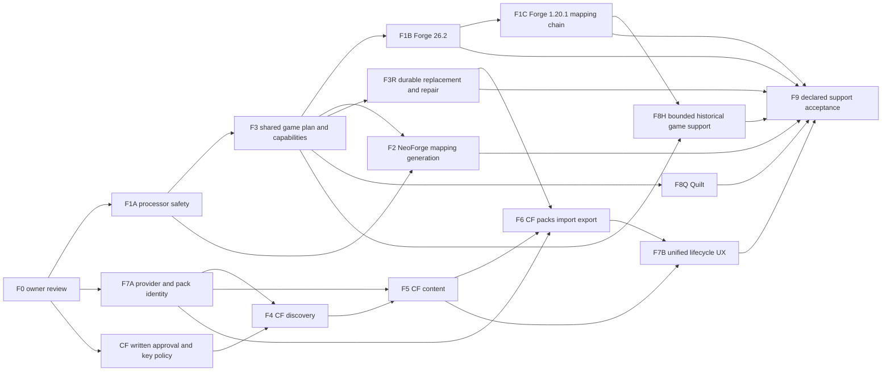

# Forge and CurseForge implementation roadmap

Prepared in F0, 2026-10-10–11, against `9890a9c8ba2b0fb64508df60d9ea8fd860a21f64`. **Proposal only. Stop after F0 for owner review.** The [audit](FORGE_CURSEFORGE_F0_AUDIT.md) and [architecture](../architecture/FORGE_CURSEFORGE_ARCHITECTURE.md) are prerequisites; the [matrix](FORGE_CURSEFORGE_COMPATIBILITY_MATRIX.md) defines the starting evidence.

## Ordering and shared acceptance rules

The original F1–F9 labels are retained, with bounded subphases. NeoForge already exists, and multi-loader identity was implemented in C1/C2; rebuilding either wastes effort and increases regression risk. Provider/pack identity work must precede CF activation. Processor safety and durable operations must precede promises of safe arbitrary loader installation or reliable pack repair.

Recommended order:

1. **F1A** processor safety/output evidence, then **F3** shared composition/exact capabilities, followed by **F1B** Forge 26.2.
2. **F1C** Forge 1.20.1 mapping generation and **F2** older NeoForge as separate adapter slices after the shared mechanics are proven.
3. Independently, obtain CF written approval and deliver **F7A** exact provider/content identity. **F4** approved discovery → **F5** content activation can initially target already supported Fabric/NeoForge; they do not require Forge to exist.
4. **F3R** durable operations and **F7A/F5** precede **F6** CF packs/import/export. **F7B** unifies the completed provider lifecycle.
5. **F8Q** Quilt and **F8H** historical Minecraft are independently bounded expansion tracks; **F9** verifies only the declared shipped support set.

The graph shows dependencies, not authorization to start parallel agents or implement all phases. F9 may scope out an explicitly deferred track, but cannot claim that track passed. F4/F5 must remain disabled if approval fails; loader work can still complete.

For every implementation phase:

- Repeat repository baseline/protection checks; preserve all user changes, developer diagnostics, caches and production data. Use explicit disposable roots for tests/desktop acceptance, never normal `.minecraft` or copied owner accounts.
- Run checks proportional to changes. Native-boundary/startup changes require frontend type checking, relevant frontend tests, Rust format/all-target check/tests, production frontend/native build and real native boot where possible. Tests must use deterministic loopback metadata/artifact services; opt-in official drift checks are separate from offline suites.
- Authenticate real acceptance through the owner's normal browser interaction in the isolated app when needed. Never inject credentials or count a synthetic session/menu screenshot as authenticated gameplay.
- Capture exact game/loader/runtime/source identities, hashes/trust, build HEAD, host architecture and evidence index. Real game acceptance includes main menu, normal exit, supervised lifecycle and restart; world/server tests belong in F9 or the relevant compatibility slice.
- No release, push, replacement of the installed Launcher or update-authority mutation is implied by phase completion. An owner-approved release is separate.

Model guidance uses the [official model catalog](https://developers.openai.com/api/docs/models), retrieved during F0, and the available host models. `gpt-6-astra` at high/xhigh is recommended for security, schemas and cross-document transactions; `gpt-6.1-sol` at high for bounded adapters/UI. Recommendations do not replace review or test gates and do not authorize delegation.

## F1A — Harden the existing processor boundary

| Requirement | Plan |
| --- | --- |
| Objective | Make current NeoForge processor behavior explicit and bounded before expanding executable installers |
| Dependencies | F0 owner review; decision on supported-host enforcement and official-tool trust policy |
| Exact scope | Stream-capped output/Unicode-safe diagnostics; bounded manifest/archive reads; immutable input hashes; output count/size/allowlist; reject symlink/reparse/special-file effects; preserve official output expectations; private copied inputs; timeout/child cleanup; prove chosen OS execution policy. Retain current NeoForge 26.x behavior; no new versions yet |
| Modules | `neoforge/{metadata,plan,processors}.rs`, `install/*`; narrow reusable `install/processors.rs`; shared bounded capture usable by `runtime/install.rs` |
| Risks | Tool code has same-user authority without OS isolation; private paths/env clearing alone are insufficient. Native restrictions can prevent legitimate Java/native reads. Descendant processes may escape simple timeout handling |
| Required tests | Safe disposable fake tools: output flood, multibyte diagnostics, oversized manifests/output, modified input, unexpected/missing output, bad expected digest, links/reparse, cancellation/timeout/descendants; actual outside-write/network denial under the selected OS policy; cache unchanged; rollback on each failure |
| Native acceptance | Repeat isolated NeoForge 26.2.0.88 install, authenticated launch/menu/exit/restart and AppleSkin baseline using managed Java 25; inspect resource limits and precise failures without owner data |
| Completion | Measured live bounds and output/ownership evidence; documented residual authority; no new execution profile advertised until enforcement/trust gate passes; current acceptance retained |
| Rollback | Keep new capability off; revert the execution change as a focused code rollback while retaining valid old installed manifests. Never delete generated owner data or downgrade new state automatically |
| Recommended model | `gpt-6-astra`, xhigh |
| Screenshots | Required for native regression/menu and user-visible processor failure; logs/fixture evidence additionally prove limits |

## F3 — Finish shared game composition and exact capabilities

| Requirement | Plan |
| --- | --- |
| Objective | Remove misleading Fabric ownership of shared plans and prevent family fallback |
| Dependencies | F1A mechanics established; can prepare a behavior-preserving move separately after F0 |
| Exact scope | Move/reexport `GameInstallPlan`/shared library roles into `game/plan.rs`; exhaustive concrete loader dispatch; exact operation/MC/version/host capability decisions; explicit library selection/exclusion roles; preserve existing platform wire names, optional Aurora and desired/installed semantics. No new loader enabled by the move |
| Modules | `fabric/plan.rs`, new `game/plan.rs`, `instances/{platform,lifecycle,settings}.rs`, `install`, `launch/resolve`, `application.rs`, `backend.ts`, instance creation/settings |
| Risks | Library order or argument changes regress launch; accidental loss of Aurora protection; enum representation mistaken for install support; DTO casing drift |
| Required tests | Byte-equivalent current normalized fixtures/launch contributions; no Fabric fallback for Forge/Quilt; Vanilla has no loader; exact capability negative cases; old registry fixtures; serialization contract tests; deterministic conflict policy |
| Native acceptance | Vanilla 1.21.11, Fabric 0.19.5 with/without Aurora, existing NeoForge 26.2; creation choices, unsupported generation reasons, save/stale/install and restart |
| Completion | One shared planner/executor path, separate real adapters, exact gates, existing pins/schema behavior preserved and no unsupported choices offered |
| Rollback | Behavior-preserving reexports permit a focused move rollback; no data migration solely for relocating types or enabling an already represented family |
| Recommended model | `gpt-6-astra`, high |
| Screenshots | Required for capability-driven selection/settings and native regressions |

## F1B — Forge 26.2 foundation

| Requirement | Plan |
| --- | --- |
| Objective | Install and launch the first bounded Forge generation |
| Dependencies | F1A and F3; executable-tool policy passed |
| Exact scope | Official Forge Maven discovery, exact MC/artifact version mapping, SHA-1 installer/library verification, supported spec-1 bootstrap profile and client patch step, structured ForgeBootstrap launch groups. Research fixture: 26.2-65.1.3; confirm a chosen production support pin before acceptance. No GUI installer, server install, automatic upgrades or older Forge |
| Modules | New `forge/{metadata,plan,mod}.rs`; shared processor/core composition; lifecycle/capabilities; installed-state and launch consistency; native version picker |
| Risks | Profile drift, tool-only libraries leaking into classpath, unknown tokens, generated-output expectations, platform-specific module arguments; SHA-1 sidecars are not independent signatures |
| Required tests | Official captured fixtures plus loopback artifact hashes; wrong MC/version/spec, unsupported token/mode, server-only step exclusion, classpath order, unknown inheritance, cache poisoning, processor failures and staged-marker semantics |
| Native acceptance | Exact Forge 26.2, managed Java 25, independent instance, verified install, authenticated genuine Forge menu, one compatible mod if available, duplicate-launch exclusion, exit 0/restart and repeat cache reuse |
| Completion | Exact support pin and host documented in matrix as Verified only after acceptance; old Vanilla/Fabric/Aurora/NeoForge regression gates pass |
| Rollback | Disable only Forge capability for unsupported/new requests; preserve represented/pinned records and installed data; code revert must fail safely rather than reinterpret a Forge record as Fabric |
| Recommended model | `gpt-6.1-sol`, high; security review with Astra recommended as a separate owner-authorized step |
| Screenshots | Required: creation/installed identity, main menu, Running and returned Ready, incompatible request |

## F1C — Forge 1.20.1 mapping generation

| Requirement | Plan |
| --- | --- |
| Objective | Support a widely used Forge generation with the real multi-step pipeline |
| Dependencies | F1B; same execution policy and composition guarantees |
| Exact scope | Exact representative 1.20.1-47.4.26 fixture: MCP data, mappings, split/rename/patch, bracketed ZIP/TXT resources, ordered client processors, BootstrapLauncher/module-path roles and output verification. Base MC 1.20.1 already uses current nonlegacy native metadata shapes. No 1.18.2/1.16.5/1.12.2 promise |
| Modules | `forge/metadata`, `forge/plan`, shared processor input/output vocabulary, library-role composition, launch placeholders/argument validation |
| Risks | Generated outputs consumed by subsequent processors, intermediate cleanup, game versus tool Java requirements, explicit library overrides and exact expected-output semantics |
| Required tests | Each step and full chain with fake tools and exact fixtures; wrong intermediate hashes, missing input, side filtering, ordering, private inputs, failure at every boundary, no unverified activation, Java 17 requirement/availability |
| Native acceptance | Exact Forge 1.20.1, managed Java 17, compatible provider/local mod, menu and basic world, exit/restart, deliberate reinstall/validation and user sentinel preservation |
| Completion | Full chain and launch verified for declared pin/host; truthful rejection of unimplemented legacy generations |
| Rollback | Gate this generation independently of Forge 26.2; keep prior complete installation/recovery copies; never roll back user world data as part of loader rollback |
| Recommended model | `gpt-6-astra`, high/xhigh |
| Screenshots | Required: identities, processing/review, menu/world and Ready after exit |

## F2 — Extend existing NeoForge, preserve 26.x

| Requirement | Plan |
| --- | --- |
| Objective | Add older mapping profiles and correct NeoForge metadata semantics |
| Dependencies | F1A, F3; can proceed independently of Forge adapter delivery |
| Exact scope | Keep 26.2 acceptance; add exact 1.21.1/21.1.1 mapping-generation fixture first. Correct required/optional-if-present/incompatible/discouraged handling, language loader versus NeoForge version, side/Java features and multiple mod IDs per JAR. Broader 1.20.x versions remain separate explicit slices |
| Modules | Existing `neoforge/*`, shared processor core, `instance_mods`, `mod_compatibility`, provider context/capabilities |
| Risks | Treating Forge and NeoForge versioning/profile/token rules as identical; TOML subset silently losing fields; multiple capabilities accidentally granting duplicate ownership |
| Required tests | Separate official profiles, mapping chain, rejected generations, loader/language ranges, side rules, optional present wrong-version, incompatible fatal/discouraged warning, multiple entries and nested capabilities, Java 21 and 25 regression |
| Native acceptance | Existing 26.2/Java25 plus new 1.21.1/Java21 in independent instances; compatible/incompatible mod reviews, authenticated menus/world/exit/restart |
| Completion | Exact supported generation list, corrected semantics and no regression to 26.x. Pack support remains off until pack phase accepts it |
| Rollback | Disable new generation independently; keep old readers/26.x behavior; preserve new records read-only if older code cannot execute them |
| Recommended model | `gpt-6-astra`, high |
| Screenshots | Required for both generations and dependency diagnostics |

## F7A — Exact provider and pack identity foundation

| Requirement | Plan |
| --- | --- |
| Objective | Make shared provenance capable of CF, local sources and multiple files per project |
| Dependencies | F0 owner review; independent of loader execution and CF credentials |
| Exact scope | Implement content 4→5, registry 5→6 and pack 2→3 only alongside actual typed records/readers; exact entry IDs/edges, source versus owner, typed expected digests, local/pack source identities, disabled/retention/pin/divergence preservation. Keep adapter compatibility wrappers for current Modrinth behavior. No live CF API activation |
| Modules | `instance_content`, `instances/mod`, `pack_state`, `content_recognition`, `content_updates`, `pack_update`, small `providers/mod`, synchronized DTOs |
| Risks | Ambiguous historical project-scoped edges, mistaken SHA-512-as-file-ID migration, loss of explicit retention or pack ownership, older binaries rejecting new state |
| Required tests | Serialized schemas 1–4 content/2–5 registry/1–2 pack; deterministic IDs; exact edge mapping; ambiguous refusal; malformed/future refusal; migration interruption/backup; hash algorithm separation; local/launcher source never fabricated; current Modrinth lifecycle regression |
| Native acceptance | Disposable copies of representative synthetic old documents, migrate/restart, Modrinth install/update/remove and current Fabric pack update; no owner data migration during development |
| Completion | Migration-safe source/owner model and exact graph with current user behavior retained; documentation of downgrade limits and backup recovery |
| Rollback | Do not auto-downgrade. Keep new documents and disabled mutation under old code, or explicitly restore a verified consistent pre-migration backup before further operations |
| Recommended model | `gpt-6-astra`, xhigh |
| Screenshots | Required for unchanged installed ownership/update behavior; schema correctness additionally needs fixture evidence |

## F4 — Approved CurseForge discovery

| Requirement | Plan |
| --- | --- |
| Objective | Browse CF using an authorized, current API integration |
| Dependencies | F7A facade/typed identities; **written approval** for Aurora use, key delivery, caching and persistence; never borrow another launcher's key |
| Exact scope | Native official API DTO boundary, separately scoped secret transport, projects/types/categories/game-loader filters, search/sort/pagination, details/files/authors/artwork, release channels and permission-aware summaries. Existing Browse gains a compact source selector. No artifact activation yet |
| Modules | New `curseforge/{metadata,policy,mod}.rs`, provider facade, `application.rs`, `backend.ts`, existing Browse/detail components and image policy |
| Risks | Published terms prohibit assumed key distribution/cache/competitive use; redirects leak credentials; description/image injection; wrong project-wide compatibility inference; unsupported categories |
| Required tests | Deterministic loopback API fixtures; credentials redacted/nonserializable; host/redirect scoping, 401/403/429/offline/revoked, bounded bodies/pages/images, numeric ID precision, stale provider/instance responses and exact loader mapping |
| Native acceptance | Approved live search/details across supported content classes; permission/rate-limit/error presentation; switching providers and instances preserves correct independent filters/pages |
| Completion | Approval recorded without credentials; authenticated live behavior confirmed; discovery failure has no effect on installed inventory or Play. If approval is unavailable, mark blocked and keep feature disabled |
| Rollback | Disable CF facade/capability; Modrinth/local remain usable; remove no source records or installed files; follow approved credential revocation policy |
| Recommended model | `gpt-6.1-sol`, high |
| Screenshots | Required for source selector, details, unavailable/restricted/error states |

## F5 — CurseForge content installation and updates

| Requirement | Plan |
| --- | --- |
| Objective | Install approved CF mods/resource packs/shaders through existing verified lifecycle |
| Dependencies | F4, F7A; target only implemented loader capabilities; documented CDN auth/manual flow permission |
| Exact scope | Expected SHA-1 content sources, exact project/file compatibility and distribution policy, bounded required graph, optional/embedded/tool/include/incompatible semantics, explicit review, manual file grants, updates/removal and provenance. No guessed CDN, automatic cross-provider fallback, MD5-only managed install or ordinary update of pack-owned files |
| Modules | CF adapter/policy, `cache`/content source dispatch, `instance_content`, compatibility/recognition/update summaries, native file picker/review |
| Risks | Authenticated redirect hosts, no acceptable hash, changed file metadata, wrong dependency type, inherited same-user content collision, rate-limit storms and false shader-runtime promises |
| Required tests | Loopback SHA-1/size failures/corrupt hits, no key on unrelated hosts, restricted/null URL, wrong manual file, no-hash refusal, graph limits/cycles/shared parents/exact pins, stale fingerprints, activation/state rollback and ownership protection |
| Native acceptance | Approved automatic file and restricted/manual case where permission allows; exact CF identity after restart; shared dependency update/removal; installed packs/launcher requirements protected; provider offline leaves ready launch intact |
| Completion | Exact approved flows work and denied flows fail clearly without mutation; recorded original source and expected/observed hashes remain distinct |
| Rollback | Disable new acquisition/update; keep installed inventory and verification source-independent. Revert an operation only through its exact verified rollback copies/receipt |
| Recommended model | `gpt-6-astra`, high |
| Screenshots | Required: dependency review, permission/manual pending, installed source, update/remove effects and failures |

## F3R — Durable operations, verification and scoped repair

| Requirement | Plan |
| --- | --- |
| Objective | Close cross-process/crash windows before generalized repair and pack configuration replacement |
| Dependencies | F3; can progress alongside provider work. Coordinate game-state format changes with F7A without combining unrelated migrations |
| Exact scope | Per-instance/exact-runtime OS locks; durable journal for game replacement and linked documents; installed game 2→3 with generated/native output proof; read-only verification and reviewed scoped repair; optional normalized template-only plan receipt for cold offline Play as a separately accepted substep. No user-content cleanup or historical world rollback |
| Modules | `install`, `runtime/install`, `instances/lifecycle`, `launch/boundary`, `pack_activation`, `pack_update`, paths/state persistence and maintenance DTOs |
| Risks | Windows rename/fsync behavior, receipt spoofing, uncertain old/new state, lock ordering, network under locks, malformed state overwrite, token leakage through persisted launch data |
| Required tests | Terminate/restart between every journal/rename/document step; two processes competing; changed/missing backups; unknown receipt/schema; links and containment races; no-network recovery; no mutation outside owned paths; offline receipt context/source mismatch; user sentinel preservation |
| Native acceptance | Isolated interrupted install/update recovery, second-process busy result, validate/repair known managed damage, unchanged user files; cold offline launch only if receipt substep is included and separately passes |
| Completion | Each injected failure recovers a proved old/new complete state or gives an honest recovery-required blocker with retained evidence; exact repair plan cannot touch unowned files |
| Rollback | Preserve journal/new schemas and safe refusal; no downgrade or cleanup of unresolved evidence; verified pre-operation restoration only with matching hashes/ownership |
| Recommended model | `gpt-6-astra`, xhigh |
| Screenshots | Required for recovery/repair/busy states; crash proof also requires structured logs and byte comparisons |

## F6 — CurseForge packs, local import and reviewed export

| Requirement | Plan |
| --- | --- |
| Objective | Normalize supported CF packs into the existing independent-instance/reconciliation model |
| Dependencies | F5, F7A, F3R; support exact selected loader generations only |
| Exact scope | Manifest-v1 ZIP normalization, exact game/loader/project/file pins, explicit optional/manual files, bounded overrides and placement, new independent instance, generic pack ownership, three-way updates; native local CF ZIP and mrpack import. Export as a separate rights/representability review using references plus authorized overrides. NeoForge mrpack support only as a specifically tested normalization slice |
| Modules | `curseforge/pack`, `mrpack`, `modpacks`, `pack_state`, `pack_update`, `pack_activation`, registry, pack review/import/export commands and UI |
| Risks | Manifest overrides-root traversal as well as ZIP traversal; duplicate/case collisions/zip bombs; conflicting primary loaders; missing restricted files; overwriting divergent config; exporting private/licensed files; mismatched pack/game markers |
| Required tests | Official/source-backed format fixtures, malformed/version/type/loader rejects, archive/path/link/size limits, wrong project/file, optional selection, manual pending, all crash points, old/new/local reconciliation, keep-local divergences, duplicate ownership and export secret/rights exclusions |
| Native acceptance | Approved small Fabric and Forge/NeoForge pack on implemented generations, import/restart, restricted required file remains incomplete, optional omission, divergent config update, interrupted recovery and inspected export/reimport. No undisclosed production pack telemetry |
| Completion | Exact supported format/generation/type list; no partial Ready; pack pins/provenance survive update/restart; exports are explicit and rights-limited. Format unsupported cases fail before activation |
| Rollback | Keep original authored snapshot and verified operation backups; restore only proved owned paths/linked documents. Never restore entire instance over user saves; no automatic schema downgrade |
| Recommended model | `gpt-6-astra`, xhigh |
| Screenshots | Required: pack review/options/manual requirements/progress, installed identity, conflict/update/recovery and export review |

## F7B — Unified provider lifecycle and explicit source changes

| Requirement | Plan |
| --- | --- |
| Objective | Present Modrinth, CF and local content coherently without erasing source restrictions |
| Dependencies | F5/F6 and F7A; can deliver ordinary-content UX before pack-specific rows, with clearly bounded scope |
| Exact scope | Existing Browse source selector and consistent installed provenance/owner badges, update actions and dependency previews; exact-hash recognition; separately reviewed alternate-source fulfillment/source transfer preserving historical request and new source. Independent per-provider query/category/sort/page caches according to approved terms. No blended rank or silent cross-provider update |
| Modules | Provider facade, recognition/content-update/lifecycle modules, installed artwork, `backend.ts`, existing content/Browse/review components |
| Risks | Same-name/project/mod-ID false equivalence, byte equality mistaken for removal rights, provider-owned versus pack-owned source transfer, ambiguous alternative requirement satisfaction |
| Required tests | Same-name different bytes, same bytes different ownership, multiple files/project, exact source transfer with incoming deps/pins, disabled/unknown rejection, stale review, provider outage, UI race and accessible native interaction tests |
| Native acceptance | Mixed Modrinth/CF/local instance, explicit denied and allowed recognition/source choices, pack-owned protection, independent update/remove semantics after restart, source outages without readiness regression |
| Completion | Every installed row/operation preserves source, owner and exact dependency evidence; existing Aurora glass/navigation and user workflow remain coherent |
| Rollback | Hide new source-transfer actions while retaining exact records; no silent reassignment or deletion. Existing provider-specific safe actions remain available |
| Recommended model | `gpt-6.1-sol`, high; use Astra for nontrivial graph changes |
| Screenshots | Required across Browse/Installed/reviews, long names, restricted files and compact window layouts |

## F8Q — Quilt as a distinct later adapter

| Requirement | Plan |
| --- | --- |
| Objective | Add bounded Quilt installation and truthful Fabric-compatibility reporting |
| Dependencies | F3; independent of CF approval and historical game support for an initial 1.20.1 target |
| Exact scope | Official Meta v3 exact catalog/profile, hashed/intermediary/library composition and published hashes, Quilt Knot main class, native provider tags, `quilt.mod.json` reader and family predicates. Initial reviewed exact loader/game pin; no automatic Aurora support or universal Fabric/QSL claim |
| Modules | New `quilt/*`, composition, platform/provider capability maps, mod inspection/compatibility, exact loader picker |
| Risks | API list ordering, metadata generation changes, conditional/alternative dependencies, multiple/nested provides, digest-less libraries, discontinued QSL assumptions and partial Fabric compatibility |
| Required tests | Official exact profile fixtures, hashes/missing hashes/trust, inheritance and classpath, unknown expressions, representative Quilt-only and compatible/incompatible Fabric mods, rejected unsupported generations |
| Native acceptance | Exact Quilt 1.20.1/managed Java17, Quilt-only sample and an upstream-supported Fabric sample, truthful incompatible sample, menu/world/exit/restart and provider filtering |
| Completion | Only evidence-backed combinations advertised; Quilt and Fabric capabilities remain distinguishable; Aurora stays Fabric-only |
| Rollback | Disable Quilt execution for new actions, preserve exact records and ownership; no conversion of Quilt pins into Fabric |
| Recommended model | `gpt-6.1-sol`, high |
| Screenshots | Required: exact selection, identity/compatibility, menu and installed sources |

## F8H — Historical Minecraft in explicit generations

| Requirement | Plan |
| --- | --- |
| Objective | Extend base-game shapes without pretending old Forge is already covered |
| Dependencies | F3 and F1C; each generation depends only on the relevant new base/loader semantics |
| Exact scope | Separate slices: H1 1.18.2 and 1.17.1 native classifiers/extract + Java17/16; H2 1.16.5 spec-0 mapping + Java8; H3 1.12.2 legacy game argument grammar and exact installer generation; H4 1.7.10 LaunchWrapper/tweaker/native/assets behaviors. Keep old beta/alpha and untested variants rejected. Loader/version/OS allowlist expands per slice |
| Modules | `minecraft/{metadata,plan,rules}`, native planner/extractor, runtime availability, Forge generation adapters, strict legacy argument normalization and launch placeholders |
| Risks | Legacy assets/logging/library URLs, unsupported official runtime component/platform, Java8 security age, legacy argument grammar, ancient mods/native ABI, no ARM fallback, obsolete patch mechanisms |
| Required tests | Per-generation first-party fixtures and exact SHA-1; last-match rules/OS/arch classifiers, META-INF/duplicate natives, arguments with spaces/quotes as individual tokens, unsupported historical shapes, asset layouts/logging, Java8/16/17 exact component gaps and unknown-placeholder failures |
| Native acceptance | Separate recorded Vanilla and loader installs/launches for each slice on declared hosts; representative worlds/mods, native loading, exit/restart and isolated user-data preservation. No universal historical claim from one menu |
| Completion | Each slice changes only its declared matrix rows; untested generations/architectures remain unavailable. Host security/legacy-runtime product policy documented |
| Rollback | Disable the newly added slice; keep all pins/readers and user files. An incompatible old world is not repaired or downgraded by changing the loader |
| Recommended model | `gpt-6-astra`, high/xhigh |
| Screenshots | Required per generation and native failure mode; structured runtime/classpath evidence also required |

## F9 — Declared mainstream-launcher acceptance

| Requirement | Plan |
| --- | --- |
| Objective | Demonstrate reliable complete workflows across the declared support set, not feature-count parity |
| Dependencies | Completed selected F1–F8 tracks, reviewed support matrix and unresolved gates explicitly deferred/disabled |
| Exact scope | Matrix-driven fresh/warm/install/reinstall/verify/repair/update/pack/import/export runs, real authenticated menus/worlds/server where appropriate, provider restrictions/outages, restart/crash recovery, large content collections, native resource checks and existing Aurora/Client/Launcher-update regression. No release publication in this phase |
| Modules | Acceptance fixtures/evidence/docs and scoped fixes only; reuse existing app and release verification paths, never change production authority for a test |
| Risks | Overclaiming platform coverage, hidden online dependencies, permissions expiring, large pack resource use, user-world damage, screenshots masking missing backend invariants |
| Required tests | Full required repository suite/builds; deterministic error/crash/concurrency/security tests; selected opt-in upstream drift checks; leak/redaction/credential-scope checks; no owner data mutation; cold/warm timing and bounded output/memory/disk behavior |
| Native acceptance | Windows x64 first. Linux/macOS require implemented OS credential stores, packaging and actual host-native acceptance before full support claims. Exercise supported Java majors/loader pins/mod types/pack operations, normal and failed exits, duplicate process exclusion and preserved user sentinels |
| Completion | Evidence-indexed matrix identifies exact Verified rows, component-only results, blockers and explicit Unsupported rows. Existing Aurora exact pins/updates/auth/session behavior retained; no unexplained data loss or unbounded operation. Deferred gates are not hidden |
| Rollback | Disable failing new feature/generation; restore only proved operation backups; keep diagnostic/recovery evidence; no blanket downgrade, mass cleanup or user-world restoration |
| Recommended model | `gpt-6-astra`, high, with bounded Sol implementation tasks only if owner-authorized |
| Screenshots | Required for every changed native flow and representative game menus; security/recovery correctness also requires hashes/logs, not screenshots alone |

## Owner gates and handoff

Before selecting implementation work, settle processor host/trust policy, CF written permissions/credential/cache model, highest-priority exact versions, schema backup/downgrade policy and import/export/source-transfer permissions. Existing authentication and release authority are constraints, not new workstreams to redesign.

Every phase ends with a focused reviewable change, preservation comparison, evidence and an updated matrix. A failed or unapproved gate leaves the relevant capability disabled; unrelated phases and installed instances remain usable. **Do not start F1 or any other implementation phase automatically after F0.**
