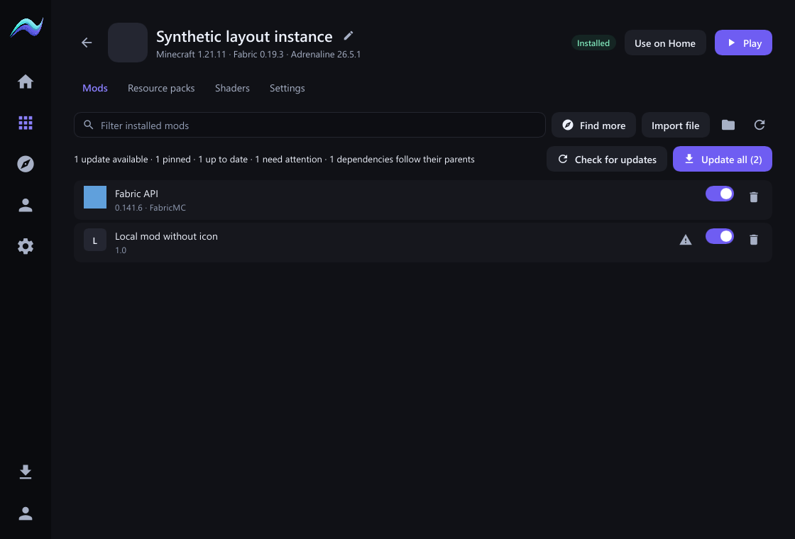
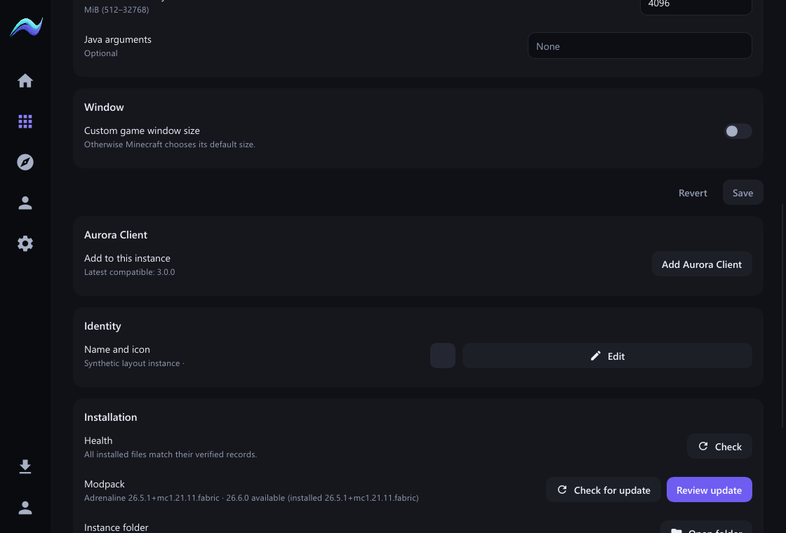
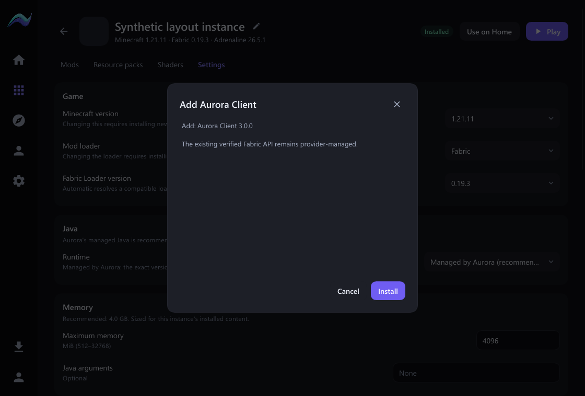
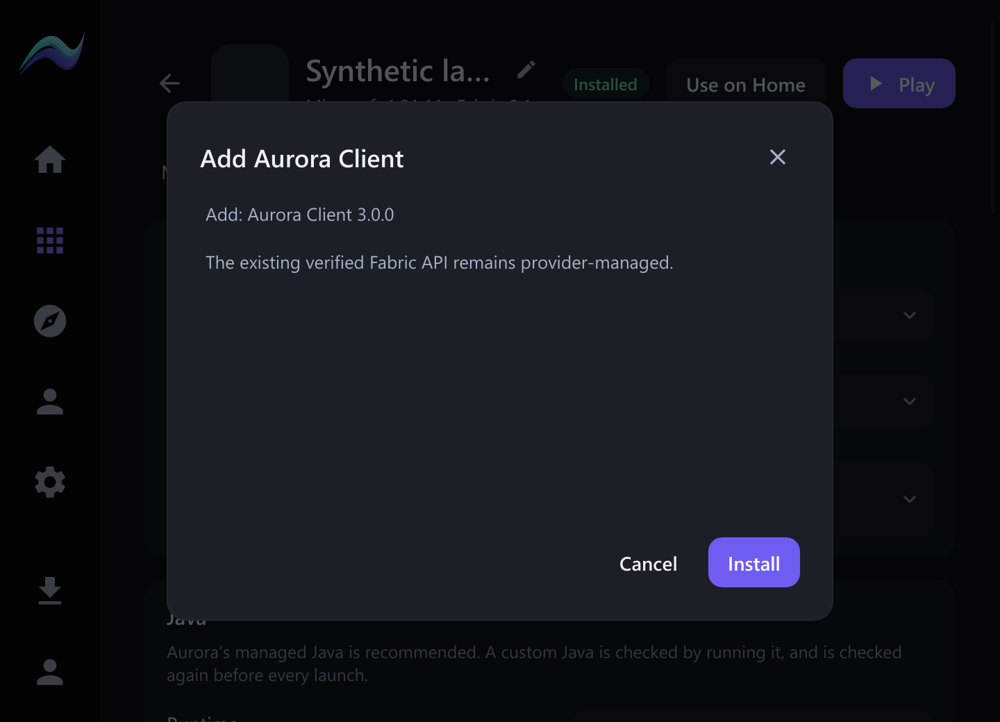

# Installed mod controls, icons and optional Aurora Client

Owner-requested follow-up to `docs/development/ui/LAUNCHER_REFINEMENT_ACCEPTANCE.md` (2026-11-01).

## Behavior

- Every contained regular mod JAR has an on/off toggle and delete action, including direct provider content, pack components/overrides, local JARs, and launcher bootstrap/required files. Dependency problems are warnings in the row tooltip rather than restrictions on deliberate local actions. Missing, unreadable, directory, link or reparse-point entries do not authorize filesystem changes.
- Mutations still require a current opaque entry identity and matching inspected bytes, validated containment, exclusive instance content ownership and a stopped game. Toggle failure restores the filename/receipt; deletion updates provider/pack ownership and records pack exclusions. Installation and launch verification retain their own integrity/compatibility checks.
- Mod icons are read locally from Fabric JSON or Forge/NeoForge TOML metadata. Static PNGs become aspect-preserving thumbnails no larger than 48×48, displayed at 32px. Unsupported, absent, malformed or animated images use a letter fallback. There are no icon network requests or per-frame decoding.
- Icon work runs off the UI thread, in requests of at most 128. The core memo holds at most 512 digest-keyed results (including negative results). Workspace images are retained only for the current inventory, and stale asynchronous results cannot replace another instance's rows. Cold JAR reads verify the inventory digest; cached cosmetic pixels do not authorize installation or launch.
- Instance Settings → Aurora Client offers Add Aurora Client, with a concrete review and verified rollback-safe installation. Remove uses the same transaction. Selection is the greatest stable semantic version in the authoritative catalog matching the exact installed Minecraft and Fabric versions. The operation preserves the game, instance identity, pack identity and existing provider ownership. An active verified pack/provider Fabric API is reused, without a duplicate launcher-owned API or a fabricated ownership receipt.
- Same-game pack reconciliation preserves the Aurora pin. A pack update changing Minecraft or Fabric is blocked while Aurora is configured, with an instruction to remove Aurora first. No loader is silently changed.

## Compatibility limits

The current production catalog offers Aurora 3.0.0 for Minecraft 1.21.11 / Fabric 0.19.5. Existing 0.19.3 instances therefore show no compatible release. Unsaved/stale game settings, a running game, incomplete installation, or failed current validation must be resolved before an Aurora transition. Arbitrary local Fabric API JARs are not adopted as provider ownership; ambiguous/conflicting identities remain review blockers.

## Verification

- Shared native core: **1,099 passed, 31 ignored**. Includes provider-API pack add/remove/re-add with complete readiness after each step, unchanged pack/provider receipts, latest-version numeric ordering, exact loader mismatch, existing transaction rollback/stale/tamper tests, source-independent mod controls and dependency warnings.
- Native suite: **43 + 5 passed**. Additional real-component pointer and Escape tests passed for the Client action/review.
- WebView contract: frontend check 0 errors/warnings; **301 frontend tests passed**; production frontend build and default-host Rust all-target check passed.
- Rust format and whitespace checks passed. No dependencies, schemas or lockfiles changed.
- Test icon measurement: one synthetic 128×64 PNG JAR cold load **1.545 ms**; **100 warm lookups 25.578 ms** total. Output was **4,608 bytes** (48×24 RGBA). This is a local bounded-work measurement, not a claim about universal frame times or startup improvement. Whole-app frame-time/CPU impact was not re-profiled for this follow-up.
- Disposable Fabulously Optimized pack: **47 mod files all offered both controls; 46 icons rendered**, the remaining file used a fallback. Cold icon acquisition took **0.94 s** in the debug host; the repeated batch took **0.01 s**. Both passes recorded **zero network transfers and zero downloaded bytes**. These batches ran through the same typed application API; the disposable pack/user state was not changed.
- Renderer acceptance uses actual Slint components/software rendering at 720×520, 1120×760 and 1600×1000, with minimum-size scaling at 100%, 125%, 150% and 200%. Pointer dispatch, keyboard editing and Escape checks pass. Captures are synthetic acceptance states, not an installed user's profile. Existing shared theme/control tokens are reused; there are no new decorative effects or continuous animations.

## Optimized application boot

The optimized native preview build completed successfully (`release`, ThinLTO, local disposable-root acceptance capability). The updated launcher was reopened at `C:\Dev\aurora-pandora-evidence-20261101\native-target\release\aurora-native.exe`, and Windows returned its Aurora Launcher window. Size: **34,611,712 bytes**. SHA-256: `393c7c5b61d291db632a89120f7d2e5eefbfecbfd8d8d525dd1e3e4cff2c56e2`.

The desktop inspection helper then returned **“foreground window did not report a process id”** on capture/activation, including after refreshing window selection and retrying. Further desktop automation stopped. This limits live-profile screenshot/pointer verification; the real-component rendering and interaction tests above passed. The new launcher remains open for owner use. No new package was published.

Repository tracked-file and critical-file baselines were recorded before changes. All baseline tracked files remain present; no deletion or generated game/runtime data is staged. Actual owner instances are not repaired or edited by the acceptance tests. No push or publication is performed.

**AURORA CLIENT HANDOFF: NOT YET REQUIRED**
