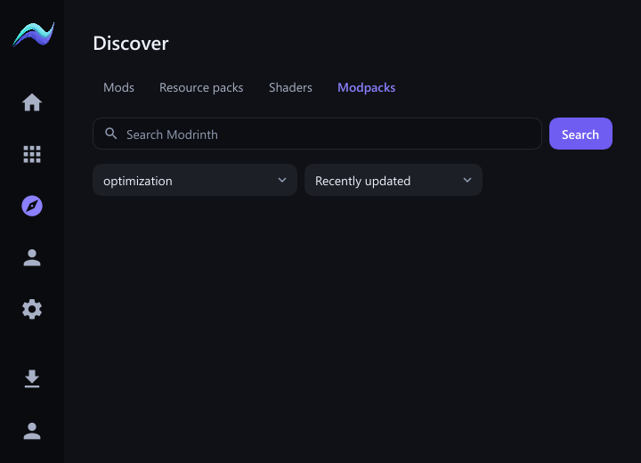
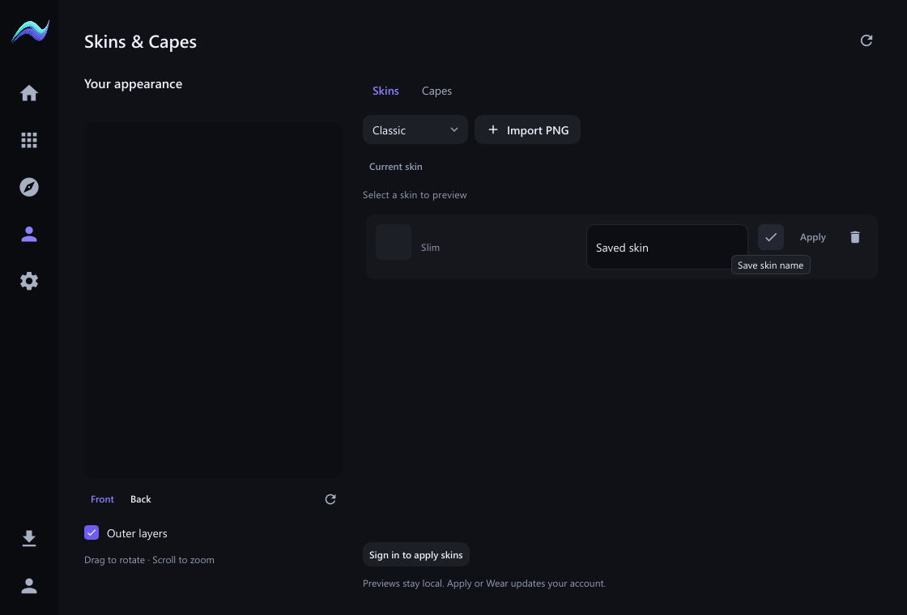
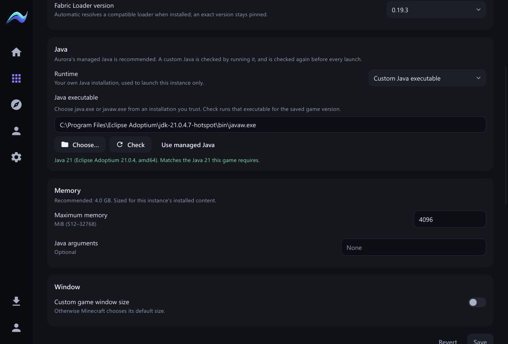

# Launcher refinement acceptance — 2026-11-01

Work is in the isolated `codex/pandora-backend` worktree. Acceptance uses marked disposable profiles; it does not change the owner's instances, skins or credentials. No Client source changes.

## Implemented behavior

- Verified modpack mod JARs expose enable/disable and delete. Disabling keeps verified ownership; deliberate removal updates provider records and pack exclusions. Changed/unsafe and launcher-required artifacts retain their guards. Rows have two text lines, with warning details on hover or keyboard focus. Folder/refresh tooltips appear above their icons.
- All four Discover types fetch live Modrinth categories and offer relevance, downloads, follows, newest and updated sorting. The provider request now uses **index**; the former **sort** parameter was ineffective. The TypeScript DTO and labels stay synchronized.
- Saved skin names have an inline editor: Enter/check to save, Escape to cancel. Favorites use their plain name in the editor. The heading is **Skins & Capes**.
- Home omits version/detail subtitles. Repeated update help and configuration prose were reduced.
- RAM uses a whole-number MiB field and the core's **512–32768 MiB** range. The old slider could offer 64 GiB against a 32 GiB core limit. The reported original crash was not independently reproduced; that slider path is replaced and native editing/saving are tested.
- Borealis keeps its atmospheric image and translucent panels with **no decorative motion or timer**. The extra callback after every native redraw was removed. The actual software-renderer test proves zero idle paints after settling.

## Fabulously Optimized and deletion

**Fabulously Optimized 12.3.0** (`1KVo5zza / K0lc692U`) installed with **50 recognized components and 70 overrides**, reaching Ready with **zero validation problems**.

BetterGrassify contains a literal newline in its metadata description. The bounded parser now handles string controls as Fabric's reader does, retaining structural/type/size checks. Exact pack files may also carry older Modrinth game-version tags: those tags remain honest provenance, while whole-pack validation checks actual JAR compatibility. Direct installs retain provider compatibility restrictions; genuinely incompatible Minecraft predicates still fail.

The full debug acceptance exposed stack exhaustion in nested installation futures. Heap-pinned boundaries fixed that workflow before the successful run.

Stopped Installing records can be deleted using the existing typed-name confirmation. Containment, link/junction, stopped-game and selection checks remain. A parent rendezvous lock protects deletion through root removal; lifecycle operations also retain the original lock. A new pack holds its lifecycle ownership from creation through the Ready commit. Active installation still blocks deletion.

Live disposable checks saved **8192 MiB**, rejected **32769 MiB**, restored the original setting, deleted two failed installations, disabled/re-enabled BetterGrassify and deleted it. Validation after disabling and deletion returned Ready with zero problems. No Minecraft process was launched.

## Pandora investigation and speed

Read-only reference: Pandora checkout `2d83d6f22c43e804d9b544e8dc98d49d4874e3af` at `C:/Dev/aurora-pandora-evidence-20261101/PandoraLauncher`.

`crates/backend/src/mod_metadata.rs` parses the archive's `modrinth.index.json`. `install_content.rs` fetches referenced content into its library and runs independent content work concurrently. A mrpack carries an index and overrides; referenced JARs still need separate acquisition.

Aurora already downloaded and parsed its verified archive first. This change replaces serial provider lookups with an ordered, bounded window of eight. Activation uses one verified installed snapshot instead of rescanning after each copied mod. Cancellation/draining, expected hashes, cache revalidation, whole-batch compatibility, protected identities, verified staging and no-clobber activation remain. Existing network limits stay 24 globally and 16 per host.

The warm-cache **debug** acceptance took 6.43 s to review, 69.46 s to install, and 7.50 s to validate, with zero transferred bytes. These are functional timings, not a cold-download comparison or a claim of parity with Pandora.

## Final desktop boot

The current optimized executable opened the owner's native profile with Borealis and the selected Vulkan 11 instance. SHA-256: `7bf103050eac90fc8a065d69df730bf204169aacdaf79415d828b6abea0bbf53`. The binary contains the final Most followed control. Boot screenshot and executable metadata are local run evidence.

That existing Vulkan instance reports a missing `mods/clientsort-fabric-2.2.2+1.21.11.jar` and ten changed pack overrides/configuration files, including options.txt. Its readiness therefore remains blocked, and the dependent managed-Java check cannot resolve. Those owner instance files were not modified by this task; no repair or replacement was performed. This is separate from the successfully installed and validated disposable Fabulously Optimized instance.

## Borealis resource sample

An empty 1120×760 profile was sampled for 15 seconds after five seconds of startup. Both binaries used the same Borealis appearance. The old decorative timer was confirmed active; the changed candidate kept it static.

| Optimized candidate | CPU (% of one core) | Working set | Private memory |
| --- | ---: | ---: | ---: |
| Before | 1.14% | 47.43 MiB | 12.53 MiB |
| After renderer fix | 0.52% | 48.59 MiB | 12.47 MiB |

This is one short sample, using fat LTO before and ThinLTO after. The final sort addition postdates the changed candidate. It supports reduced idle decorative work; it does not establish input latency, game FPS or a memory reduction. Raw measurements and executable hashes are in `docs/pandora/refinement/resource-samples.json`.

## Verification and evidence

- Full core suite: **1094 passed, 31 previously ignored**. Subsequent focused checks: **70 content tests**, **38 Modrinth tests** passed (one existing ignored).
- Native: **43 unit/layout/render/input tests plus five integration tests passed**, including real RAM typing, name editing with Enter and no idle Borealis paints.
- Actual component renders cover 720×520, 1120×760 and 1600×1000 and 100–200% scale at minimum size.
- Frontend: **301 tests**, zero type-check errors/warnings. Production frontend build and native/core all-target checks were run.
- No dependencies or lockfiles changed. All baseline tracked files and critical root/native files remain present. No push or distribution publication.

Build, boot, resource samples and raw logs: `C:/Users/kalib/AppData/Local/Temp/aurora-refinement-b03bb0a9-332b-4f50-bca3-d5f2246f4015`.

The local optimized native acceptance build uses release optimization with ThinLTO and the disposable-root acceptance feature. The installed-profile boot leaves that override unset. An attempted no-LTO shortcut could not link cached bitcode libraries and was discarded.

Sources: [Modrinth search API](https://docs.modrinth.com/api/operations/searchprojects/), [Fabric 0.19.3 JsonReader](https://github.com/FabricMC/fabric-loader/blob/0.19.3/src/main/java/net/fabricmc/loader/impl/lib/gson/JsonReader.java#L941).

**AURORA CLIENT HANDOFF: NOT YET REQUIRED**
