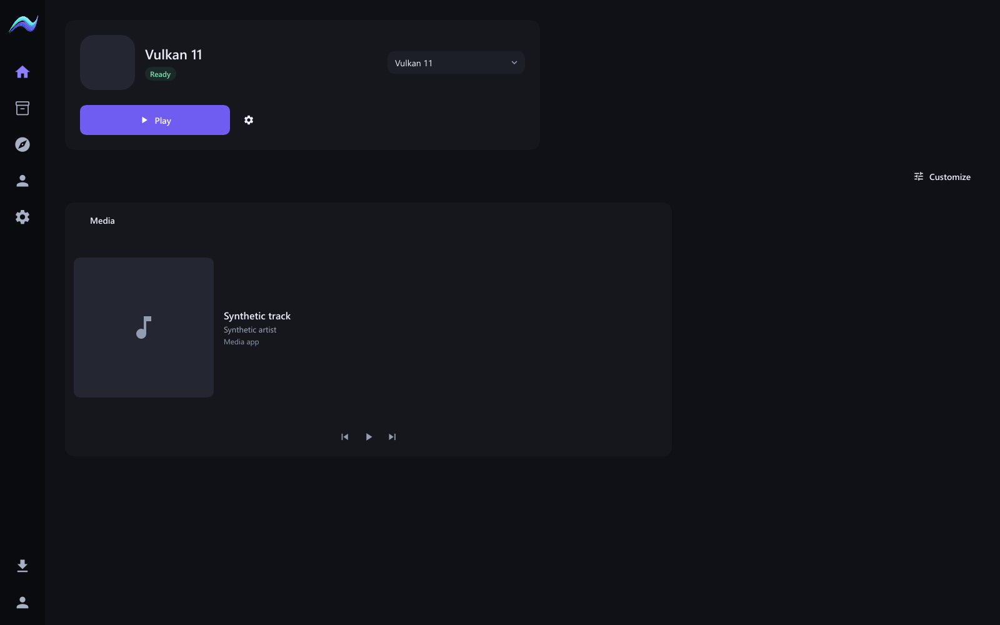
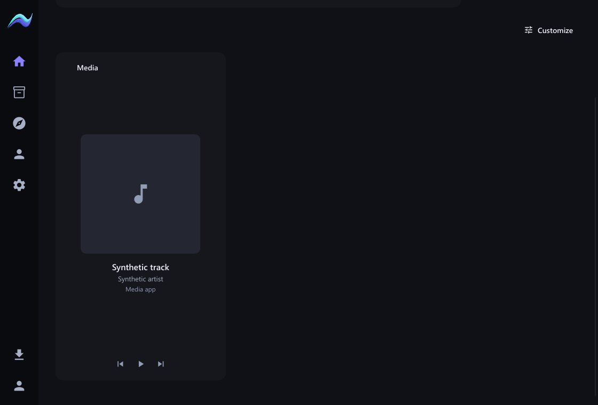
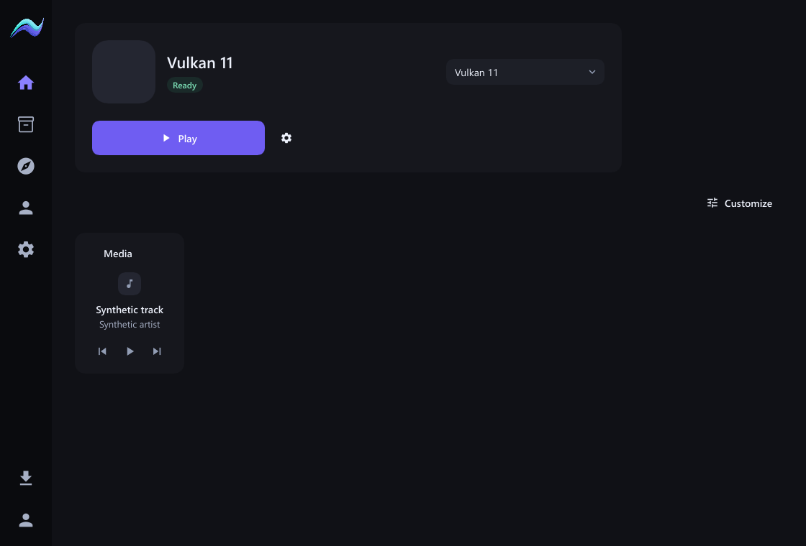

# Responsive widget content

Widget contents now respond to their card dimensions. Media uses a compact
layout at the smallest footprint, a horizontal artwork/details layout in wide
cards, and a centered vertical stack in tall narrow cards. Artwork scales within
bounded available space, while playback controls stay aligned near the bottom.
Track titles use the existing larger identity type token in taller cards.
Empty list widgets center a readable bounded message. Populated lists adapt row
spacing and visible row count to the available height, revealing more entries in
larger cards. Narrow playtime cards show seven daily bars; width, rather than
height alone, determines when thirty bars are readable. Charts fill the available
height. Headers retain a consistent size and placement.

This is presentation-only Slint work. No saved card geometry, core behavior,
DTOs, dependencies, network access or polling changes. No performance improvement
is claimed without measurements. Existing drag snapping, collision handling,
removal, keyboard support and atomic saves remain in place.

The headless acceptance matrix includes compact, wide, large and tall media,
empty tall lists, populated compact/tall lists, and narrow tall charts. Every
scene renders at 720x520, 1120x760 and 1600x1000, with minimum-window scaling at
100%, 125%, 150% and 200%. Captures use synthetic data, not owner artwork.

Verification: all 49 native tests passed, including real pointer activation of
playback after wide and narrow/tall card resizing. Existing drag snapping,
cancellation, collision, chart-data and no-idle-frame regressions also pass.
Native checking, formatting and whitespace checks pass. The new scene matrix was
rendered and visually inspected at representative compact, wide and tall sizes.

Live optimized acceptance follows below.

**AURORA CLIENT HANDOFF: NOT YET REQUIRED**
