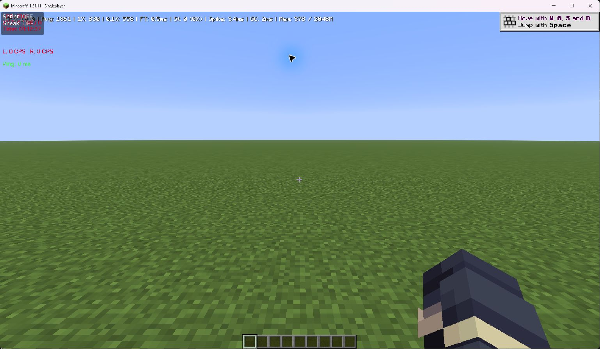
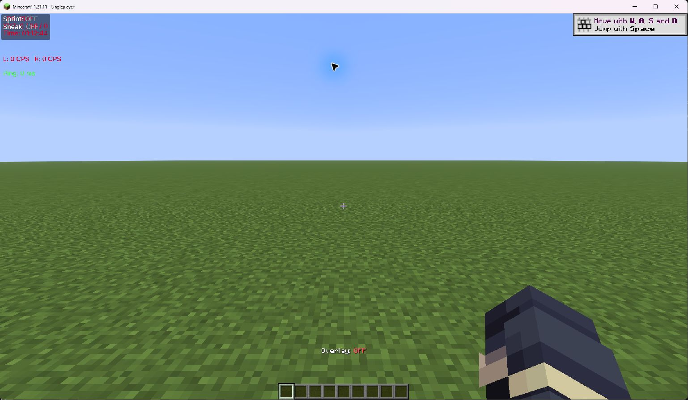

# Actual isolated execution and deferred recordings

**Startup/world compatibility verified for Performance Overlay; recording remains
UNTESTED.** [Runtime evidence](evidence/p3a4a2/runtime.json),
[attempt register](evidence/p3a4a2/trials.json),
[raw output inventory](evidence/p3a4a2/raw-inventory.json).

Before startup, validated the established marked direct-temp root, all ancestors
and descendants for reparse boundaries, launcher SHA-256, managed Java identity,
separate managed/WebView paths. Native get_application_status matched the root;
live WebView command-line observation matched its separate profile. This is not
independent proof of every WebView filesystem access. Previously approved startup
refresh ordering and same-user Credential Manager continuity risk remain explicit.
Normal Rust session refresh, entitlement/readiness and play succeeded; no interactive
sign-in was needed. No production credentials/tokens were read or exported.

Created one new disposable instance through normal native creation and runtime
validation. Pinned Minecraft 1.21.11 / Fabric 0.19.5 / Aurora 3.0.0 /
Fabric API 0.141.6+1.21.11 / Sodium 0.8.14+mc1.21.11 /
Lithium 0.21.4+mc1.21.11. Rehashed base artifacts; no copied production instance.
New world is a full inventory-equal copy of frozen A restoration, not a canonical
B workload. Frozen options copied byte-for-byte before launch. Test-owned Aurora/
Sodium/Lithium configuration copied from prior isolated B; original B not changed.

JVM settings: Existing Configuration (performanceMode null), 2048 MiB, empty
additional text and null launcher window override. Empty text/heap yield the same
reviewed JVM tuning vector as earlier Balanced/2048/empty cases; no live argument
array was exported and no JVM treatment comparison made. Saved options supply
1920x1080, windowed, native Unlimited 260 sentinel, VSync false, Minimized inactivity,
render/simulation 12/8. DPI-aware exact-PID query confirms physical client 1920x1080
at 120 DPI. Initial unaware query returned virtualized 1536x864; retained privately,
not misrepresented as a different physical resolution. Framebuffer size unobserved.

No-collector session reached Aurora main menu and received the JFR availability
queries. It exited normally, native supervisor exit 0. Only then did native provider
preview/fingerprint/verified acquisition install exact Cloth Config and Overlay.
Independent publisher SHA-1/SHA-512 checks match installed bytes; content revalidated
Ready. No downgrades, candidate patch or direct Java/game command.

Collector session reached Aurora main menu, selected the sole disposable world,
entered it and displayed live metrics. F7 hid the Overlay. This verifies coexistence
and that hide key, not recorder start/stop/CSV or runtime sampling completeness.
No F10 recording was started. Native supervisor game exit and retained-handle
launcher exit are both 0. No crash/retry or process-name termination.

Screenshots are compatibility evidence only. Visible FPS/GC values are not accepted
benchmark measurements. The tutorial toast and normal Aurora HUD remain visible;
no clean steady-state recording or completed 300-second warm-up is claimed.

| Environment / condition | Actual result |
| --- | --- |
| Initial 60 s idle | 121 samples, 0.887789% mean machine CPU, >=21878607872 available bytes, AC present |
| Fresh no-collector title 60 s | 121 samples, 2.979357% mean machine CPU, >=19796078592 available bytes; FAILED unchanged 2% screen |
| Display/driver | RX 9070 XT, 32.0.31041.1004, desktop 2560x1440/240 Hz unchanged |
| GPU idle/VRR/thermals/background stability | UNKNOWN; no global configuration changes |
| Active collector, JFR alone, combined, 240/1000 captures | DEFERRED after failed screen; no favorable retry |

Title measurement includes the game and background; it cannot identify the source
of 2.98% CPU. Retain the strict failure rather than attributing it to unrelated
processes or subtracting an unmeasured amount. No unrelated process was terminated.

Aurora PARK/smooth=true/spin500us/park2000us/lowCPU=false/lowLatency=true/
adaptive=false/disableVSync=false/GUI60 remained unchanged; global cap remained OFF.
No 240/1000 pacing result. Post-exit common NBT fields still show seed123456789,
position0.5/66/0.5, yaw0/pitch10, time6000 and clear weather. No fresh complete
entity/chunk audit or canonical B lock is inferred from that limited check.

Raw startup/log/query/quiet/screenshot evidence is retained privately. Recording
frame counts/mean/P95/P99/tails/max/missingness/buffer/CPU/RSS/GC metrics remain null.
Original captures and canonical A archive/options are unchanged.
