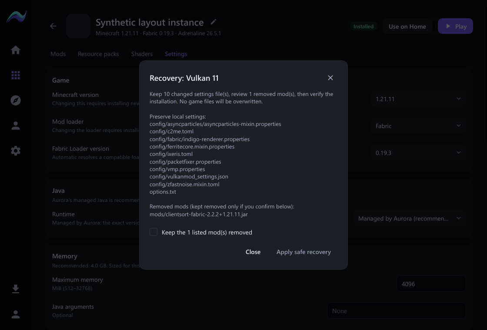
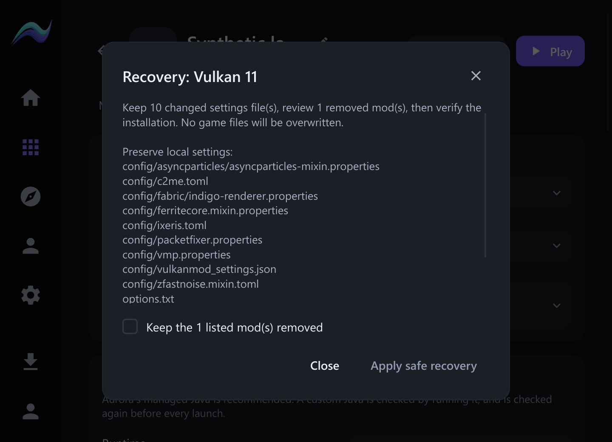
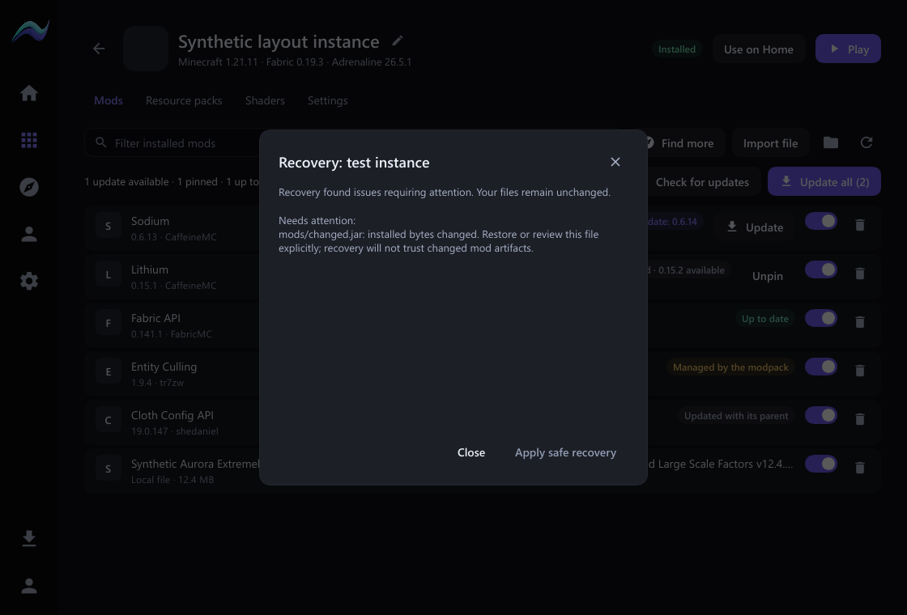

# Vulkan 11 Play crash and Smart Recovery

2026-11-01. Native-preview follow-up on `codex/pandora-backend` from `f88ec53`.

The later [Home card simplification](../development/acceptance/HOME_CARD_SIMPLIFICATION_ACCEPTANCE.md) moves visible launch messages and recovery management into instance settings. The diagnosis and verified repair behavior documented here is retained.

## Cause and instance findings

The native workspace Play callback invoked navigation from inside `ui::with`, while navigation's callback entered `ui::with` again. This caused `RefCell already borrowed` at `native/src/ui.rs:114` before Minecraft could start. A regression test reproduced this exact panic on the original code. The fixed test now drives the actual header button with a pointer press/release and reaches Home without the panic.

Vulkan 11 (`7ff825b0fd0c4ec294c83ad2a5597648`) had a separate content-state problem: an earlier game repair had committed, but the registry still said Installing because its pack receipt expected a missing ClientSort JAR and the original bytes of ten local settings files. The preserved previous game log says the server rejected ClientSort before it was removed. There is no recent game launch log from the reported launcher-navigation crash. This is evidence for preserving the removed mod, rather than restoring it without review.

## Implemented behavior

- Navigation callbacks run after releasing UI-state/window borrows. Workspace Play now selects its exact target and waits for the winning readiness check before launching, or routes to the relevant recovery/account/Java action. Navigation away or a new explicit selection cancels pending Play intent.
- Failed/blocked instance checks and unsuccessful supervised game exits automatically trigger a read-only recovery inspection. There is no background polling, restart loop, automatic mod disabling, or guess at the cause of an unknown game crash.
- Smart Recovery is available in instance Settings → Installation and from Home's recovery/failure action. It separates local settings, missing mods, and issues it cannot safely reconcile. A changed executable artifact, missing required dependency, unsafe path, unknown schema, or malformed JSON settings stays blocked.
- The review preserves bounded UTF-8 text settings (`config/` and `options.txt`), records their authored/kept hashes as divergences, and requires a separate checkbox to keep listed mods removed. Other user/game bytes are not overwritten, deleted, executed or downloaded. Missing pack records are not fabricated.
- Apply rechecks the fingerprint under content/lifecycle/process exclusion, backs up the exact original pack/provider/registry documents under the validated instance `.smart-recovery/<generated-id>/`, persists Installing before updating receipts, and commits Ready only after full content verification. Normal failures roll back metadata; an interrupted operation remains unavailable and can be inspected/resumed. Shared cache, runtime and account data are not repair targets.
- A guarded launch/recovery worker always returns a sanitized error to the UI if its Rust task panics, rather than losing completion and leaving a busy button. Readiness refresh no longer immediately erases the launch error. Unknown crashes retain their existing supervised diagnostic and direct the user to review, without blindly changing mods or Java.

## Vulkan 11 repair and preservation

The reviewed operation was applied through the same typed application command used by the new UI. It kept all ten local settings files, recorded ClientSort as excluded, removed its stale provider receipt, and completed full validation before restoring Ready. Exact original metadata backups are retained in the instance.

An independent `get_play_readiness` call then returned **ready=true**, **instance=ready**, **runtime=ready**, **account=ready**, **process=stopped**, **no blockers**, resolving Minecraft 1.21.11 / Fabric 0.19.3 / Java 21. The configured RAM remains **5120 MiB**. Preservation checks hashed **72 original files** across mods, configuration, saves, logs, resource packs, options and server lists: **none changed**. ClientSort was not restored. See [preservation evidence](../launch-recovery/preservation.json).

The older installed WebView launcher 1.5.1 was found separately and left unchanged; this work uses the native-preview application identity/profile throughout.

## Optimized boot and live Play acceptance

The optimized native build completed successfully in 9m 07s. Executable: `C:\Dev\aurora-pandora-evidence-20261101\native-target\release\aurora-native.exe`, **34,968,064 bytes**, SHA-256 `f23d832f6c000711f877a27556c9f93333abdb123b3fa9e78a74beb89fe20c78`.

Windows automation opened the updated native launcher, selected Vulkan 11's instance tile, and pressed the workspace **Play** button that originally crashed. It navigated to Home, passed through Starting, and reached **Running** without closing the launcher. The exact supervised managed Java window opened **Minecraft 1.21.11/Fabric (134 Mods)** at the main menu, verified directly in its own window. Both the launcher and game remain open. No world or server was entered. The file-preservation comparison above was taken immediately after metadata recovery, before this normal game startup.

## Verification

- Core: **1,105 passed, 31 ignored**. New tests cover local settings/removal reconciliation, explicit removal confirmation, stale fingerprints, active/preparing games, complete validation, metadata rollback with backups, resuming an interrupted reconciliation, modified executable content, missing dependencies, unknown schema preservation and malformed JSON rejection.
- Native: **45 passed**, plus **5 Java-picker/contract tests passed**. Includes the real pointer Play regression and worker-panic completion test. The recovery dialog tests verify the unchecked removal gate, one checked confirmation dispatch, and Escape dismissal.
- Frontend contract: **301 passed**, type check 0 errors/warnings, production frontend build passed. Default-host Rust all-target check passed. Rust format and whitespace checks passed. No dependency, lockfile, application identifier or persisted schema changes.
- The actual Slint software renderer captured the recovery and blocked states at 720×520, 1120×760 and 1600×1000; minimum-size scaling also covers 125%, 150% and 200%. Shared dialog, checkbox, button, focus and theme controls are reused. Long lists scroll while the confirmation/actions stay visible. Captures below are synthetic states populated with the observed relative file names, not desktop photos.
- No whole-app frame-time or idle CPU improvement is claimed. Inspection is event-driven, off the UI thread, network-free, and keeps one pending target while preserving an open review. Cryptographic validation still reads installed bytes.

Repository status, HEAD/history, tracked files and critical manifests/documentation were recorded before editing. The original C:\Dev checkout's unrelated modifications were preserved; changes are in the existing native worktree. Baseline tracked files remain present, with no deletions or generated game/runtime data included. No push or publication.

**AURORA CLIENT HANDOFF: NOT YET REQUIRED**
